# 交接說明：games_advisor

> 功能負責人填寫，交給永傑做正式頁面。格式依 AGENTS.md 5.4。

- 功能負責人：立倫
- 後端 domain：`games_advisor`（推薦 Agent）
- 前端 `state/` 位置：`frontend/lib/domains/games_advisor/state/`
- 參考畫面路由：`/proto/games_advisor`（啟動需帶 `--dart-define=SHOW_PROTOTYPES=true`）

玩家用聊天的方式說出人數、時間和喜好，推薦 Agent 會追問條件，或推薦最多 3 款桌遊，附上推薦理由與心得片段。

## 1. 頁面清單

| 頁面 | 路由 | 用途 |
|---|---|---|
| 推薦 Agent（`prototypes/games_advisor/games_advisor_proto_page.dart`） | `/proto/games_advisor` | 和推薦 Agent 對話、看推薦卡片 |

## 2. 各頁面的按鈕與欄位

### 頁面：推薦 Agent

| 元件 | 類型 | 按下／輸入後做什麼 | `state/` 方法 | 後端 API |
|---|---|---|---|---|
| 開始新對話（AppBar） | 按鈕 | 清空訊息與 `response_id`，不跳確認視窗；不能開始新對話時停用 | `startNewConversation()`、`canStartNew` | 不呼叫 |
| 空畫面 | 說明文字＋3 個按鈕 | 點範例直接送出：「我們 4 個人，想輕鬆聊天」「2 個人約會玩」「6 個人，30 分鐘內玩完」 | `sendMessage(範例文字)` | `POST /api/v1/advisor/messages` |
| 訊息列表 | 清單 | 依序顯示玩家與推薦 Agent 的訊息；推薦 Agent 的訊息下面接放寬提示與卡片 | `messages`（`PlayerMessage`、`AdvisorReplyMessage`） | 不呼叫 |
| 放寬提示 | 文字 | 卡片上方一行，整則訊息一次，不是每張卡片各標一次 | `relaxedConstraintText()` | 不呼叫 |
| 推薦卡片 | 卡片 | 繁中名稱、資訊行、推薦理由；「心得片段（n）」預設摺疊，點開看原文，英文片段旁標「英文」；沒有片段時不顯示這一行 | `gameMetaText()`、`excerptLanguageLabel()` | 不呼叫 |
| 輸入框 | 輸入欄位 | 顯示字數；Enter 送出、Shift+Enter 換行；送出中停用 | `editDraft(text)`、`draftLength` | 不呼叫 |
| 送出 | 按鈕 | 送出輸入框的內容；不能送出時停用 | `sendMessage(draft)`、`canSend` | `POST /api/v1/advisor/messages` |
| 規則問答連結 | 文字連結 | 輸入框下方固定一行「想問規則或玩法？到規則問答」；目前停用 | — | 不呼叫 |

### `state/` 提供的東西

`advisorProvider`（`AdvisorNotifier`）的狀態：

| 欄位 | 內容 |
|---|---|
| `messages` | 對話。`PlayerMessage` 只有 `text`；`AdvisorReplyMessage` 有 `reply`、`recommendations`（卡片）、`relaxedConstraint` |
| `status` | `idle` 或 `sending` |
| `draft` | 輸入框內容。送出時清空、失敗時放回，畫面要跟著它更新輸入框 |
| `notice` | `null`、`expired`、`unavailable`，見第 3 節 |
| `responseId` | 前端保管的對話 id，畫面不用顯示 |
| `canSend`、`canStartNew`、`draftLength` | 送出鈕、開始新對話鈕能不能按；字數 |

卡片文字放在 `state/game_card_text.dart`，正式頁面直接呼叫，不要自己重寫規則：

| 函式 | 例子 |
|---|---|
| `gameMetaText(game)` | `2–4 人 · 30–45 分鐘 · 10 歲以上 · 難度 1.9 / 5`。最少等於最多時只寫一個數字（`4 人`）；難度四捨五入到小數 1 位 |
| `relaxedConstraintText(constraint)` | `以下放寬了「時長」條件`、`以下放寬了「年齡」條件` |
| `excerptLanguageLabel(excerpt)` | 英文片段回 `英文`，中文回 `null`（不標） |

字數上限用 `advisorMaxContentLength`（500）。

## 3. 狀態顯示

| 狀態 | 要顯示什麼 |
|---|---|
| 載入中（`status` 是 `sending`） | 推薦 Agent 的位置顯示「正在找桌遊…」，輸入框、送出鈕、開始新對話都停用 |
| 沒有資料（新對話） | 說明文字＋範例按鈕 |
| 錯誤：`notice` 是 `expired`（對話已失效，後端 404 `GAMES_ADVISOR_CONVERSATION_NOT_FOUND`） | 畫面清空，顯示「對話已失效，請開始新對話」，剛剛那句在輸入框 |
| 錯誤：`notice` 是 `unavailable`（其他所有錯誤：503、500、422、斷線、逾時） | 剛剛那句從畫面拿掉、放回輸入框，前面的對話保留，顯示「推薦 Agent 暫時無法回應，請再送一次」 |
| 追問、離題、查無結果、固定文字 | 只有文字，沒有卡片 |
| 沒有權限（403） | 這個功能沒有 403。推薦 Agent 不用登入就能用，所以也沒有「請先登入」的畫面；使用者權限之後再討論 |

## 4. 參考畫面截圖

截圖以 Flutter Web 開發建置（`flutter run -d web-server`，寬 800）取得，後端是 dev 模式、連真的模型與正式編號的桌遊資料。最上面一行是開發身分切換器（不是推薦 Agent 的一部分；當時的資料庫沒有測試帳號，所以顯示「尚無測試帳號」）。「對話已失效」與「暫時無法回應」是用瀏覽器工具假造後端的 404、503 回應拍的，畫面和真的發生時一樣。

| 狀態 | 截圖 |
|---|---|
| 空畫面（新對話） | 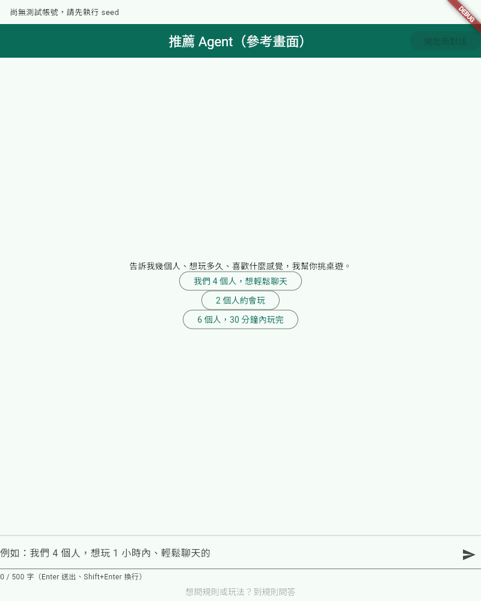 |
| 載入中 | 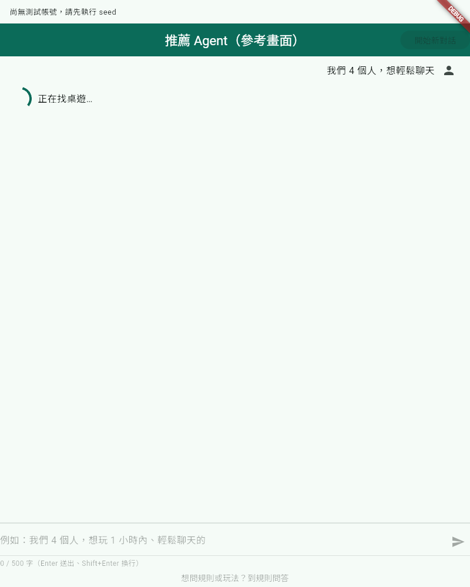 |
| 追問：只有文字，沒有卡片 | 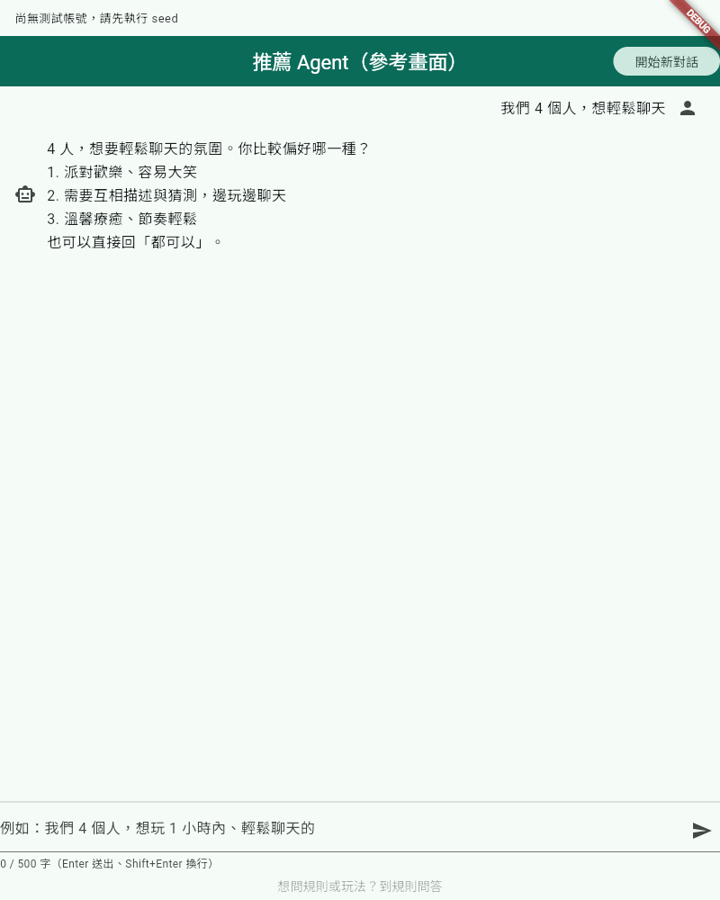 |
| 推薦卡片：心得片段摺疊 | 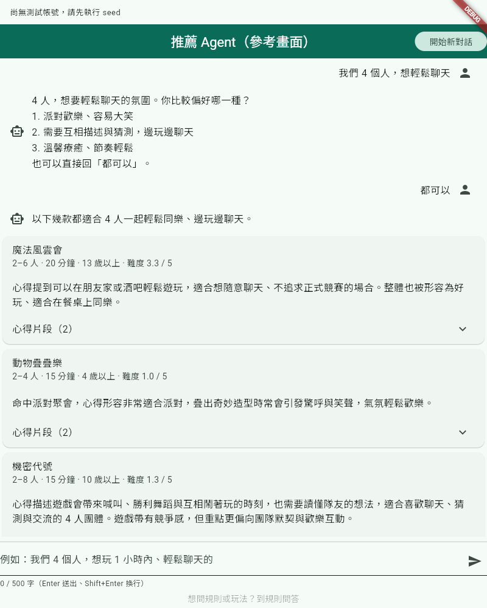 |
| 推薦卡片：心得片段展開，英文片段標「英文」 | 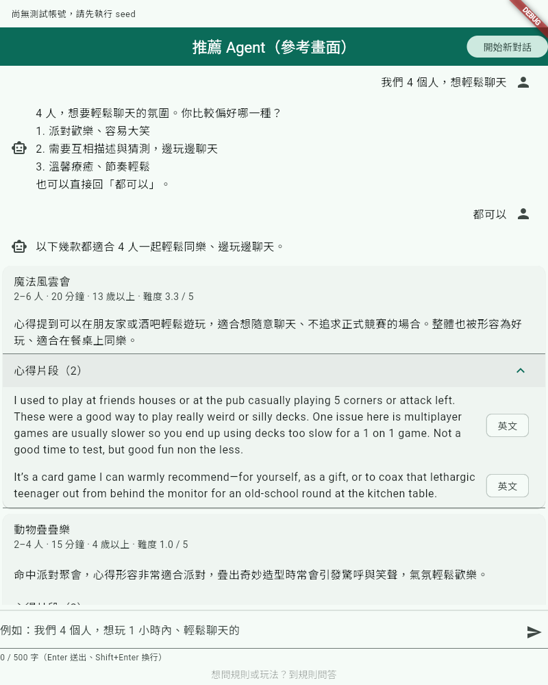 |
| 放寬提示：卡片上方一行 | 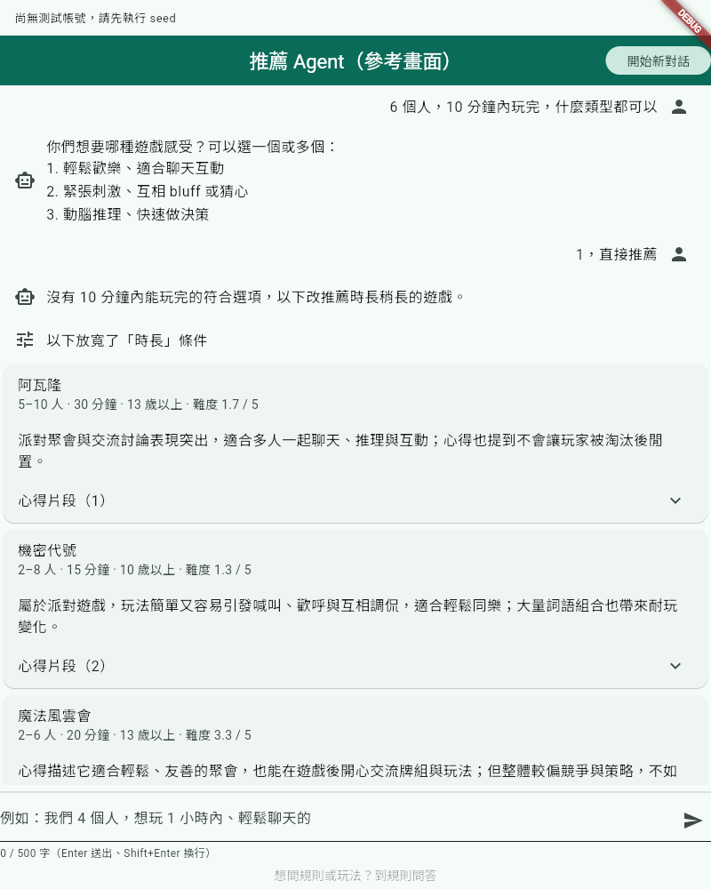 |
| 對話已失效 | 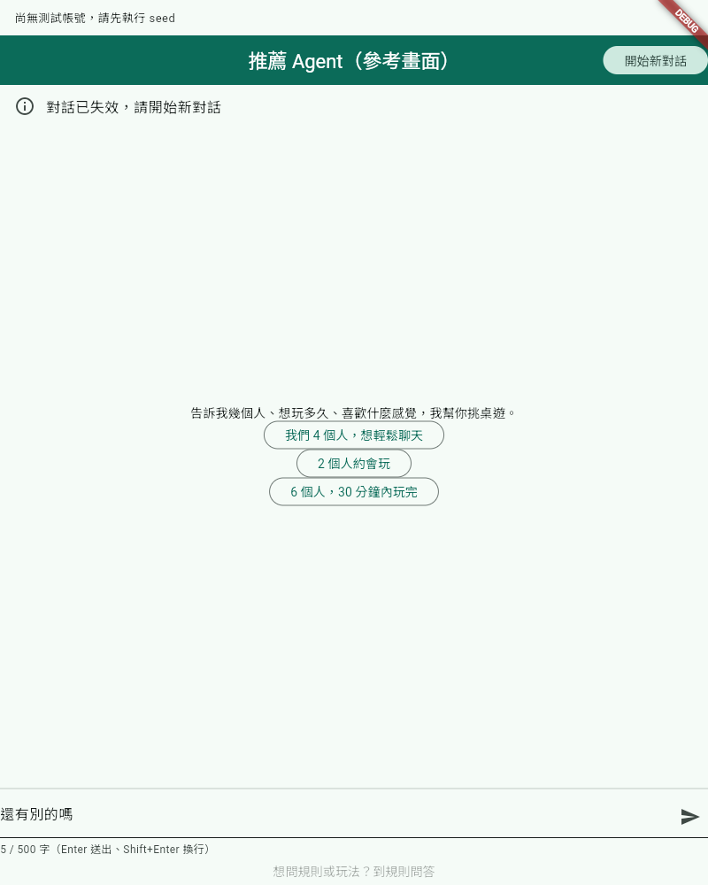 |
| 暫時無法回應：前面的對話保留，剛剛那句回到輸入框 | 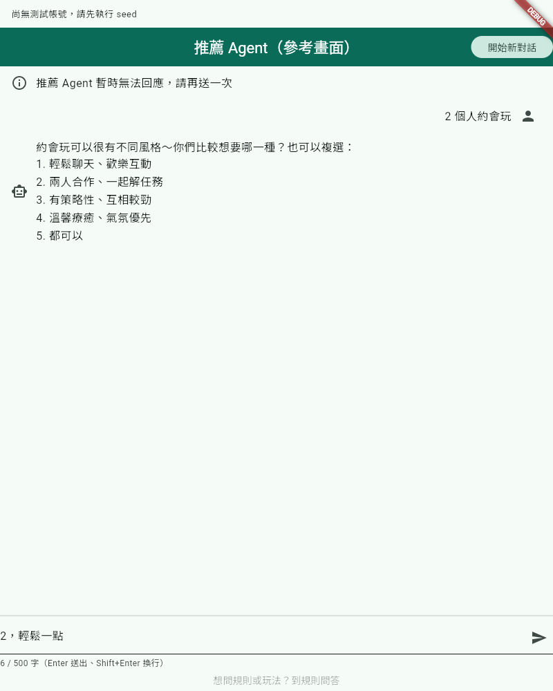 |

### 4.1 視覺方向參考（非定案）

以下三張是以 ticket 09 的實際截圖為基礎，用 `image_gen` 製作的參考設計稿，供永傑討論正式頁面的視覺方向。稿件品質已確認可供交接參考；配色、字型、間距、元件尺寸與 RWD 仍由永傑定調，不代表正式頁面已實作或設計已定案。

本輪沿用現有綠色探索，搭配米白底、少量桌遊元素與清楚的對話／卡片層次。完整的選圖理由與設計方向見 [設計稿說明](designs/games_advisor/v1/README.md)，生成提示詞見 [prompts.md](designs/games_advisor/v1/prompts.md)。

| 畫面 | 討論重點 | 參考設計稿 |
|---|---|---|
| 開始新對話 | 首頁親和感、三個範例入口與輸入區 | 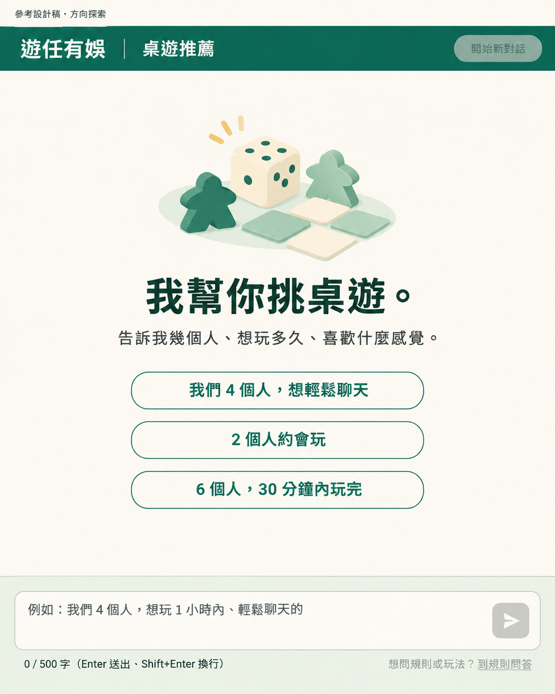 |
| 對話追問 | 玩家與推薦 Agent 的辨識、文字層次與留白 | 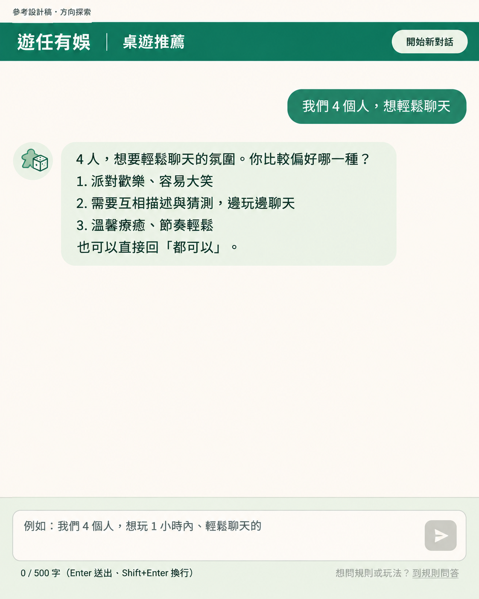 |
| 推薦結果與心得 | 桌遊資訊、推薦理由，以及心得展開／摺疊的閱讀層次 | 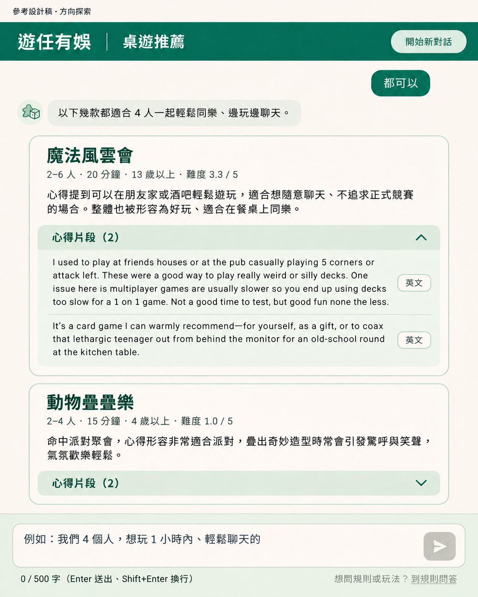 |

設計稿中的推薦頁以對話向下捲動後的位置呈現，只顯示當前可見的兩張卡片；功能仍是最多推薦三款。操作與狀態以本文件第 2、3 節為準；手機版、載入中、錯誤與放寬條件等未繪製的畫面，正式 UI 仍需涵蓋。

## 5. 給永傑的備註

- `state/` 不夠用時，回報功能負責人修改，不要在頁面直接呼叫 API。
- 正式頁面完成後，刪除對應的參考畫面路由。
- 推薦 Agent 最久要等 100 秒才回應，「正在找桌遊…」要能撐這麼久。這個上限寫在 `data/`，頁面不用處理。
- 對話不存進瀏覽器。重新整理或離開這一頁再回來，都是新對話（`advisorProvider` 是 autoDispose）。
- 心得片段只顯示原文，不顯示來源（標題、網站、連結）。這是立倫的決定，接受著作權法第 64 條「引用要明示出處」的風險。
- 規則問答連結等 `rules_qa` 有頁面再接。
- 輸入框按 Enter 送出時，輸入法還在選字的話要讓給輸入法，不然打注音按 Enter 選字就會直接送出。參考畫面的做法見 `_onKey`。
- 目前主題的 `TextButton` 字色和 AppBar 背景同色，放在 AppBar 上會看不見，所以參考畫面的「開始新對話」用 `FilledButton.tonal`。
- 後端沒有設定模型金鑰（`LLM_PROVIDER=fake`）時，送出一律是「暫時無法回應」，看不到卡片；請看上面的截圖。
