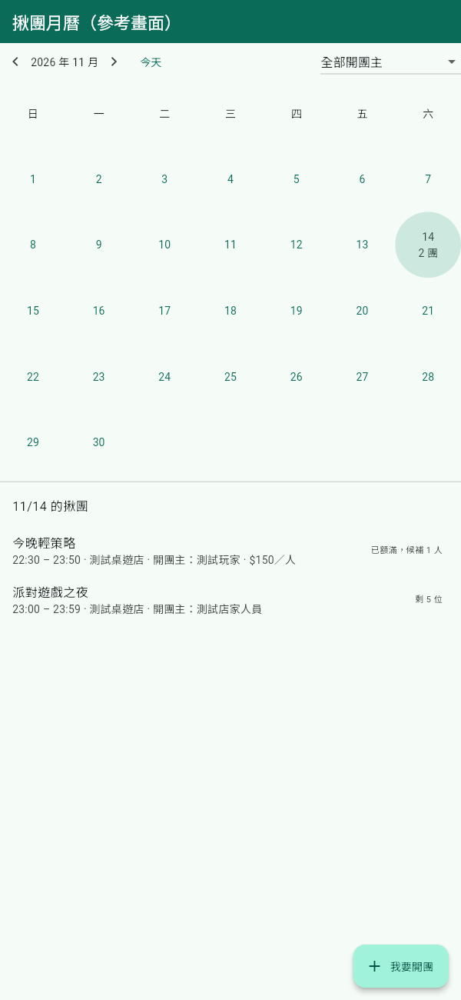

# 交接說明：groups

> 功能負責人填寫，交給永傑做正式頁面。格式依 AGENTS.md 5.4。

- 功能負責人：永傑（`groups` 主責，見 AGENTS.md 第 3 節）
- 後端 domain：`groups`（規格：`openspec/changes/add-groups-calendar/`）
- 前端 `state/` 位置：`frontend/lib/domains/groups/state/`
- 參考畫面路由：`/proto/groups`（啟動需帶 `--dart-define=SHOW_PROTOTYPES=true`）

> **狀態（2026-11-17）：正式頁面已完成**，位於 `frontend/lib/domains/groups/pages/`，路由 `/groups`。依 AGENTS.md 5.4，參考畫面 `prototypes/groups/` 與 `/proto/groups` 路由已刪除；本文件保留作為畫面行為的紀錄，下文提到的參考畫面檔案可在 git 歷史中找到。

時間一律由後端以 UTC 傳遞，`state/` 透過 `groupClockProvider` 換算成裝置時區。頁面不要自己做時區換算，一律使用 `state/` 提供的日期與 `GroupClock`。

## 1. 頁面清單

| 頁面 | 參考畫面 | 用途 |
|---|---|---|
| 揪團月曆 | `prototypes/groups/groups_proto_page.dart`（路由 `/proto/groups`） | 月曆每天顯示團數，點日期列出當天揪團；依開團主篩選；入口「我要開團」 |
| 揪團詳細 | `prototypes/groups/group_detail_proto_page.dart`（從月曆列表點進去；也可以直接開網址 `/groups/<揪團 id>`，首頁行程的揪團列連到這裡） | 揪團資訊、成員與候補名單、報名／候補／退出／編輯／取消 |
| 開團／編輯表單 | `prototypes/groups/group_form_proto_page.dart`（從月曆或詳細頁進入） | 建立或修改揪團 |
| 通知列表 | 無（直接做正式頁面 `pages/group_notifications_page.dart`，路由 `/groups/notifications`） | 成團、解散、候補正取的站內通知（add-groups-notifications） |
| 通知鈴鐺 | 無（`pages/widgets/notification_bell.dart`，放在導覽列） | 顯示未讀數，點下前往通知列表 |

正式頁面的路由（例如 `/groups`、`/groups/:id`）由永傑在做正式頁面時決定（tasks.md 4.x）。

## 2. 各頁面的按鈕與欄位

### 頁面：揪團月曆

`state/`：`groupsCalendarProvider`（`GroupsCalendarNotifier`）

| 元件 | 類型 | 按下／輸入後做什麼 | `state/` 方法 | 後端 API |
|---|---|---|---|---|
| 年月文字 | 文字 | 顯示目前月份 | `GroupsCalendarState.month` | — |
| 上個月／下個月 | 按鈕 | 切換月份並重新載入 | `previousMonth()`／`nextMonth()` | `GET /api/v1/groups?start_from=&start_before=`（超過 100 團會自動載入後面的分頁） |
| 今天 | 按鈕 | 回到本月並選取今天 | `goToToday()` | 同上 |
| 開團主篩選 | 下拉選單 | 「全部開團主」與「名稱（N 場）」；選擇後月曆團數與當日列表只算該開團主 | 選項 `organizerOptionsProvider`；選擇 `setOrganizer(id)`（null 為全部） | 不另外呼叫，前端篩選 |
| 日期格 | 按鈕 | 選取該日；有揪團時顯示「N 團」。今天以前的日期停用（文字變淡、點不下去），但照樣顯示團數 | `selectDate(date)`；團數 `calendarCountsProvider`；選取日 `GroupsCalendarState.selectedDate` | — |
| 當日列表 | 清單 | 依開始時間排序。每筆顯示：標題、時段、店家、開團主、遊戲（有才顯示）、費用（沒填不顯示，0 顯示「免費」）、名額狀態 | `selectedDayGroupsProvider`；名額文字 `groupSlotLabel(group)` | — |
| 列表項目 | 點擊 | 進入揪團詳細 | — | — |
| 我要開團 | 按鈕 | 開啟開團表單，日期預設為目前選取的日期 | `groupFormProvider.notifier.reset()` 後開表單 | — |

### 頁面：揪團詳細

`state/`：`groupDetailProvider(groupId)`（`GroupDetailNotifier`，autoDispose，頁面開著時才保留）

| 元件 | 類型 | 按下／輸入後做什麼 | `state/` 方法 | 後端 API |
|---|---|---|---|---|
| 揪團資訊 | 文字 | 標題、名額狀態、日期與時段、店家、開團主、成員數／上限、候補數、費用、遊戲、簡介 | `GroupDetailState.group` | `GET /api/v1/groups/{id}` |
| 名單 | 清單 | 先列成員（開團主第一位），再列候補（標示「候補第 N 位」） | `GroupDetailState.members` | `GET /api/v1/groups/{id}/members` |
| 報名 | 按鈕 | 報名，成功提示「報名成功」 | `join()` | `POST /api/v1/groups/{id}/members` |
| 加入候補 | 按鈕 | 同上（額滿時顯示），成功提示「已加入候補，目前第 N 位」 | `join()` | 同上（回 201，`status=waitlisted`） |
| 退出 | 按鈕 | **先跳確認對話框**，確定後退出，提示「已退出揪團」；成員退出時後端自動讓候補遞補 | `leave()` | `DELETE /api/v1/groups/{id}/members/{自己的 id}` |
| 編輯 | 按鈕 | 開啟表單並帶入現有的值 | `GroupFormData.fromGroup(group, clock)` | — |
| 填入戰績 | 按鈕（開團主與正式成員；候補沒有） | 導向 `/matches?group_id=<揪團 id>`，只帶揪團 id；戰績頁自己讀揪團帶入名稱、店家與遊戲（見 matches 交接說明） | `groupMatchLink(group)` | — |
| 確定成團 | 按鈕（開團主；揪團開放中且還沒成團） | **先跳確認對話框**（說明會通知所有成員、之後不能取消成團），確定後送出，提示「已確定成團，已通知所有成員」 | `confirm()` | `PATCH /api/v1/groups/{id}`，`{"confirmed": true}` |
| 已成團 | 停用的按鈕（所有人） | 已成團且開放中時出現在按鈕列，按不下去；開團主的「確定成團」由它取代。已取消或已結束時不顯示 | `GroupAction.confirmed` | — |
| 取消揪團 | 按鈕 | **先跳確認對話框**，確定後取消，提示「已取消揪團」；後端會通知成員與候補 | `cancel()` | `PATCH /api/v1/groups/{id}`，`{"status": "cancelled"}` |
| 成功提示 | 文字 | 上一個操作成功的訊息 | `GroupDetailState.message` | — |
| 錯誤提示 | 文字 | 上一個操作失敗時，顯示後端的 `message` | `GroupDetailState.error` | — |

要顯示哪些按鈕，一律用 `state.actionsFor(ref.watch(currentUserIdProvider))` 決定，頁面不要自己判斷：

| 情況 | 按鈕 |
|---|---|
| 開放中、未報名、還有名額 | 報名 |
| 開放中、未報名、額滿 | 加入候補 |
| 開放中、已是成員或候補 | 退出 |
| 開放中、我是開團主 | 編輯、訂位、填入戰績、確定成團（已成團時變成停用的「已成團」）、取消揪團 |
| 開放中、已成團、我不是開團主 | 原本的按鈕，加上停用的「已成團」 |
| 已取消或已結束 | 不顯示按鈕 |

報名、退出、取消成功後，`state/` 會自動重新載入詳細資料與月曆，頁面不需要另外處理。

### 頁面：開團／編輯表單

`state/`：`groupFormProvider`（`GroupFormNotifier`）；表單資料 `GroupFormData`

| 元件 | 類型 | 按下／輸入後做什麼 | `state/` 方法 | 後端 API |
|---|---|---|---|---|
| 店家 | 下拉選單＋文字欄位 | 下拉選單列出當月揪團出現過的店家；文字欄位可直接貼店家 ID（見第 5 節）。編輯時不顯示（店家不能改） | 選項 `knownShopsProvider`；欄位 `GroupFormData.shopId` | — |
| 標題 | 文字欄位 | 必填 | `title` | — |
| 日期 | 日期選擇器 | 必填；只能選今天以後（編輯日期已過的揪團時，從今天開始選） | `date` | — |
| 開始時間／結束時間 | 時間選擇器 | 必填；結束要晚於開始（不支援跨午夜） | `startTime`／`endTime`（從 00:00 起算的 `Duration`） | — |
| 人數上限 | 數字欄位 | 必填，至少 2（含開團主） | `capacity` | — |
| 每人費用 | 數字欄位 | 選填，0 以上整數 | `fee` | — |
| 遊戲 ID | 數字欄位 | 選填（遊戲清單 API 尚未提供） | `gameId` | — |
| 簡介 | 多行文字 | 選填 | `description` | — |
| 送出／儲存 | 按鈕 | 先在前端驗證，有錯不呼叫 API；成功後關閉表單，月曆跳到該日 | `submit(data)`／`submit(data, groupId: id)`；回傳 `null` 代表失敗 | `POST /api/v1/groups`／`PATCH /api/v1/groups/{id}` |
| 欄位錯誤 | 文字 | 每個欄位下方顯示 | `GroupFormState.fieldErrors[欄位]` | — |
| 後端錯誤 | 文字 | 表單保留輸入內容並顯示訊息 | `GroupFormState.error` | — |

### 頁面：通知鈴鐺與通知列表

| 元件 | 類型 | 按下／輸入後做什麼 | `state/` 方法 | 後端 API |
|---|---|---|---|---|
| 通知鈴鐺 | 按鈕（平板與桌機在頂部導覽列，手機在頂部窄列） | 顯示未讀數（0 不顯示、超過 99 顯示「99+」），點下前往 `/groups/notifications`。進入應用時查一次，之後每 60 秒查一次；查詢失敗只顯示鈴鐺 | `groupUnreadCountProvider`、`unreadBadgeLabel(count)` | `GET /api/v1/group-notifications?page_size=1`（讀 `unread_count`） |
| 通知 | 清單，新的在前 | 一句說明＋揪團時間＋通知時間；未讀的底色較深、右側有圓點、文字加粗 | `groupNotificationsProvider`；文字 `notificationText(n)` | `GET /api/v1/group-notifications` |
| 通知項目 | 點擊 | 未讀的先標成已讀、鈴鐺少 1，然後進入揪團詳細；標成已讀失敗時仍然進入，該則維持未讀 | `open(notification)` | `PATCH /api/v1/group-notifications/{id}`，`{"read": true}` |
| 捲到底 | 捲動 | 還有下一頁時自動載入 | `loadMore()`；`hasMore` | 同上，帶 `page` |

通知文字：

| `type` | 文字 |
|---|---|
| `group_confirmed` | 「揪團名稱」已成團 |
| `group_cancelled` | 「揪團名稱」已取消 |
| `waitlist_promoted` | 你已從候補遞補為「揪團名稱」的成員 |

## 3. 狀態顯示

| 狀態 | 要顯示什麼 |
|---|---|
| 載入中 | 月曆：`state.groups.isLoading` 時顯示載入中，不顯示舊月份的團數（`calendarCountsProvider` 會回空）。詳細：`state.group` 載入中。操作進行中：`GroupDetailState.busy`／`GroupFormState.submitting` 為 true 時停用按鈕、顯示載入中 |
| 沒有資料 | 選取的日期沒有揪團：「這天還沒有人揪團」與「我要開團」按鈕。通知列表沒有通知：「目前沒有通知」 |
| 錯誤（依 `error.code` 區分） | 載入失敗：顯示 `ApiException.message` 與「重試」按鈕（月曆 `reload()`、詳細 `reload()`）。操作失敗直接顯示後端 `message`，常見代碼：`GROUP_CLOSED`（已取消或已結束）、`GROUP_ALREADY_JOINED`、`GROUP_SHOP_NOT_FOUND`、`GROUP_GAME_NOT_FOUND`、`GROUP_INVALID_TIME`、`GROUP_CAPACITY_BELOW_MEMBERS`、`GROUP_ORGANIZER_CANNOT_LEAVE`、`NETWORK_ERROR` |
| 沒有權限（403） | 正常操作不會發生，因為按鈕已依身分隱藏。若仍收到 403，同樣顯示後端 `message` |

## 4. 參考畫面截圖

揪團月曆（手機寬度，11/14 有兩團，其中一團額滿且有 1 人候補）：

詳細頁與表單請照第 2 節實際操作參考畫面查看。

## 5. 給永傑的備註

- `state/` 不夠用時，回報功能負責人修改，不要在頁面直接呼叫 API。
- 正式頁面完成後，刪除對應的參考畫面路由。
- **店家清單 API 尚未提供**（design.md D8，屬於 `booking`，瑋鋐負責）。在那之前，表單的店家只能從當月出現過的店家選擇，或手動貼上店家 ID。API 完成後，改由 `state/` 提供店家清單，頁面不需要改呼叫方式。
- **目前使用者 id** 來自 `currentUserIdProvider`，現在取自開發用的身分切換器；`auth` 完成後只改這個 provider。
- RWD：正式頁面依 spec，手機版月曆在上、列表在下；平板與桌機版左右並排。斷點使用 `core/layout/`。
