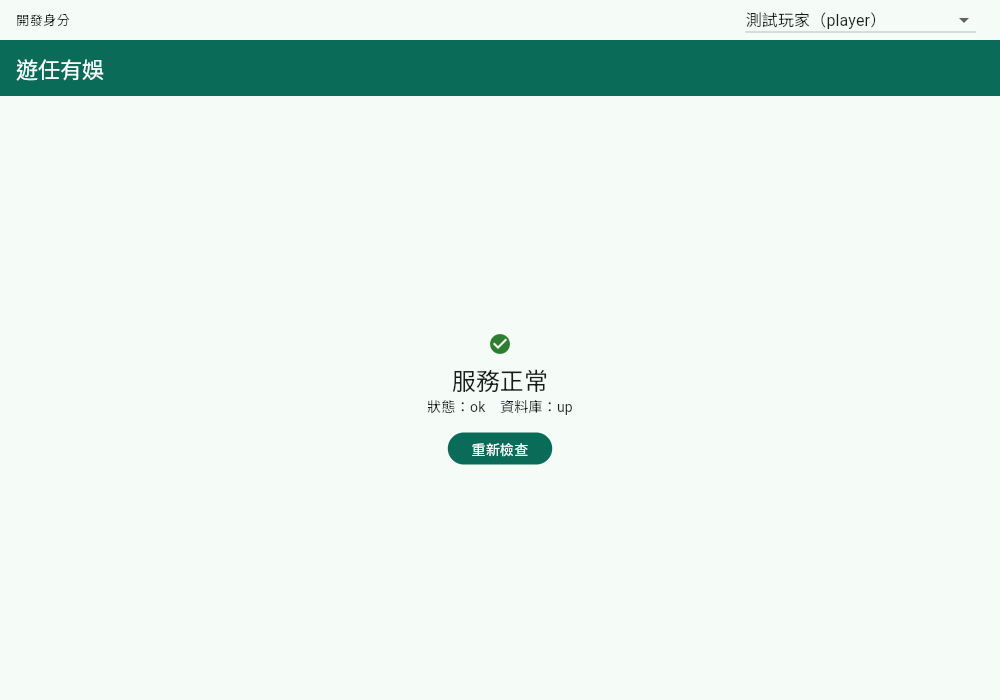
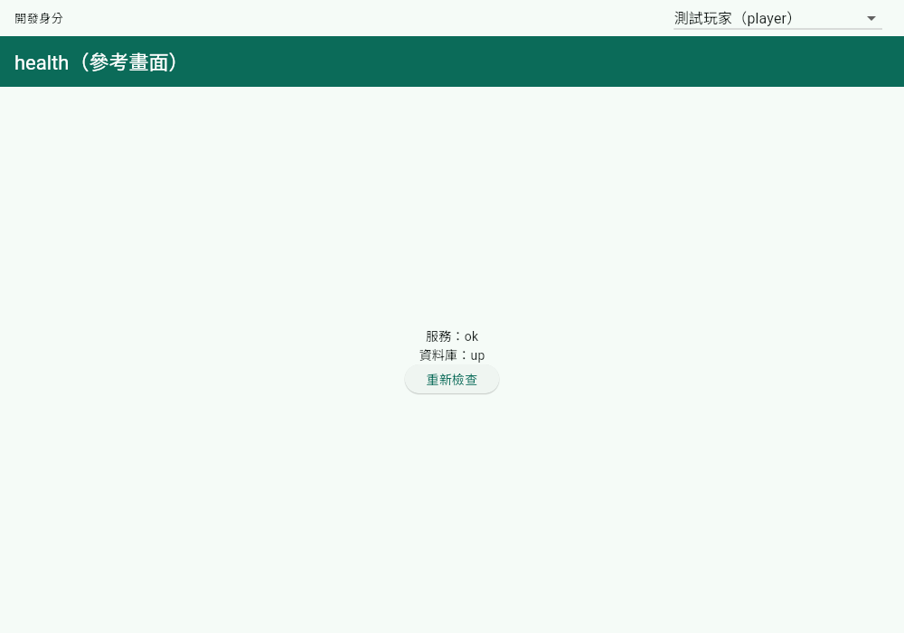

# 交接說明：health

> 功能負責人填寫，交給永傑做正式頁面。格式依 AGENTS.md 5.4。複製本檔為 `docs/handoff/<domain>.md` 再填。

- 功能負責人：立倫（`health` 為示範 domain，見 AGENTS.md 第 3 節）
- 後端 domain：`health`
- 前端 `state/` 位置：`frontend/lib/domains/health/state/`
- 參考畫面路由：`/proto/health`（啟動需帶 `--dart-define=SHOW_PROTOTYPES=true`）

> health 是示範用 domain：`pages/health_page.dart` 只是展示「正式頁面怎麼接 `state/`、怎麼用主題與斷點」，永傑可直接改寫或刪除。

## 1. 頁面清單

| 頁面 | 路由 | 用途 |
|---|---|---|
| 正式頁面（`pages/health_page.dart`） | `/` | 顯示後端與資料庫是否正常 |
| 參考畫面（`prototypes/health/health_proto_page.dart`） | `/proto/health` | 同上，只用預設元件，不套主題 |

## 2. 各頁面的按鈕與欄位

### 頁面：health（正式頁面與參考畫面功能相同）

| 元件 | 類型 | 按下／輸入後做什麼 | `state/` 方法 | 後端 API |
|---|---|---|---|---|
| 服務狀態文字（`status`：`ok`／`degraded`） | 文字 | 顯示後端回報的服務狀態 | `healthProvider`（載入時自動呼叫） | `GET /api/v1/health` |
| 資料庫狀態文字（`database`：`up`／`down`） | 文字 | 顯示後端回報的資料庫連線狀態 | 同上 | 同上 |
| 重新檢查 | 按鈕 | 回到載入中，重新呼叫一次 | `HealthNotifier.reload()` | `GET /api/v1/health` |
| 重試（只在錯誤時出現） | 按鈕 | 同「重新檢查」 | `HealthNotifier.reload()` | `GET /api/v1/health` |

### 開發用身分切換器（`core/dev/`，不是 health 的一部分）

| 元件 | 類型 | 按下／輸入後做什麼 | `state/` 方法 | 後端 API |
|---|---|---|---|---|
| 開發身分 | 下拉清單 | 選擇測試帳號；之後所有請求帶 `X-Dev-User` | `SelectedDevUserId.select()`（`selectedDevUserIdProvider`） | `GET /api/v1/dev/users` |
| 重試（清單載入失敗時） | 按鈕 | 重新載入測試帳號清單 | `ref.invalidate(devUsersProvider)` | `GET /api/v1/dev/users` |

切換器只在開發環境出現（release 建置不會顯示，也不會呼叫 `/api/v1/dev/users`）。啟動後端時需 `AUTH_MODE=dev` 並已執行 seed。

## 3. 狀態顯示

| 狀態 | 要顯示什麼 |
|---|---|
| 載入中 | 轉圈圈（`CircularProgressIndicator`） |
| 沒有資料 | health 永遠有回應，沒有「沒有資料」狀態；身分切換器清單為空時顯示「尚無測試帳號，請先執行 seed」 |
| 錯誤（依 `error.code` 區分） | 顯示 `ApiException.message` 與「重試」。無法連線為 `NETWORK_ERROR`（訊息「無法連線到伺服器」）；後端有回應時依其 `error.code` 顯示 `message` |
| 沒有權限（403） | health 不需要身分，不會出現 403 |
| 後端回報 `degraded`（資料庫 `down`） | 不是錯誤，是成功回應：正式頁面顯示「服務異常」與警示圖示 |

## 4. 參考畫面截圖

截圖以 Chrome 開啟開發建置（profile）取得，後端為 dev 模式並已 seed。

正式頁面（`/`，上方是開發身分切換器）：

參考畫面（`/proto/health`）：

## 5. 給永傑的備註

- `state/` 不夠用時，回報功能負責人修改，不要在頁面直接呼叫 API。
- 正式頁面完成後，刪除對應的參考畫面路由。
- 顏色、間距與版面寬度只能放在 `app/theme/`，頁面不得寫死數值；斷點用 `core/layout/` 的 `context.screenSize`。
- 產生程式碼的檔案（`*.g.dart`、`*.freezed.dart`）不提交；改了 `@freezed` 類別後執行 `dart run build_runner build --delete-conflicting-outputs`。
