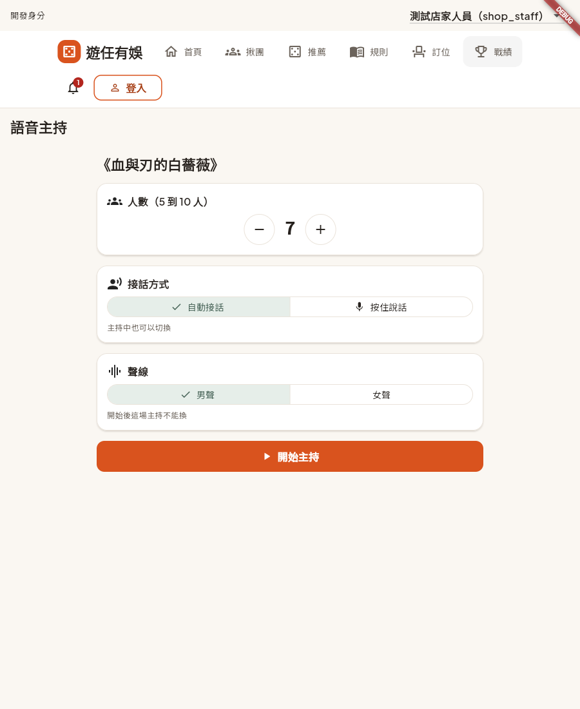
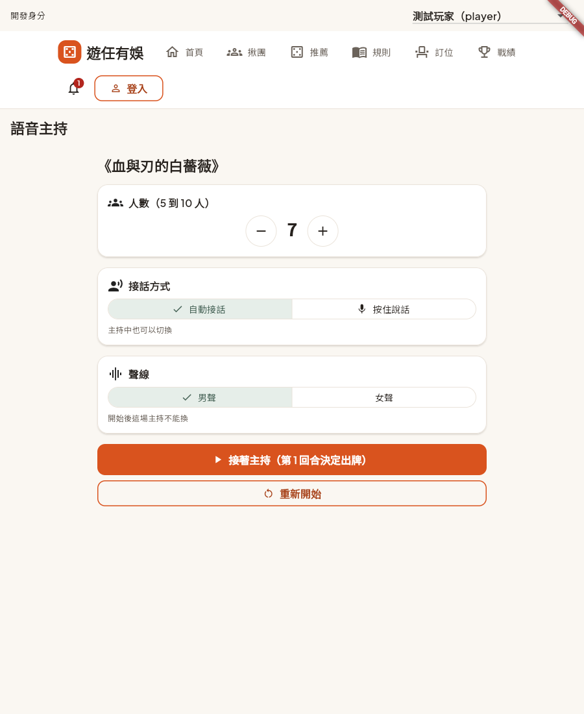
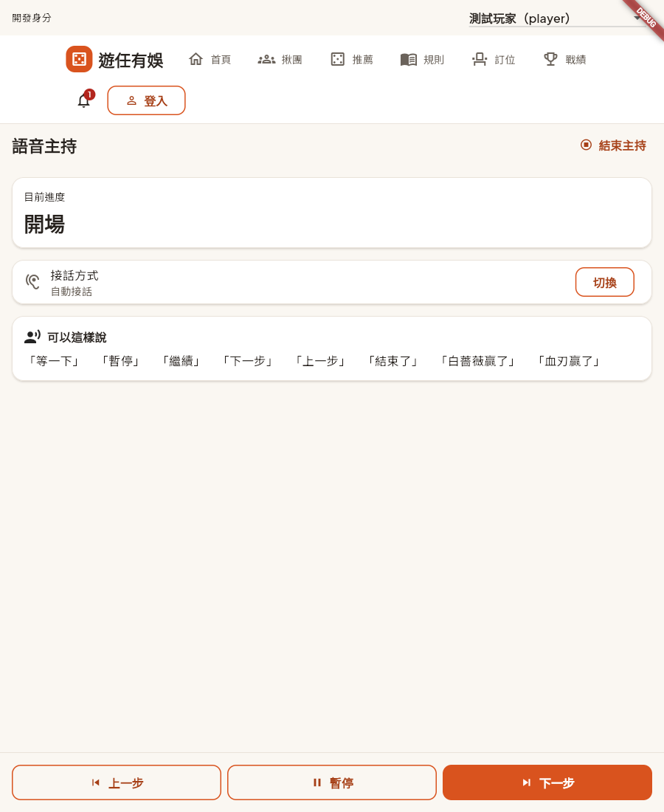
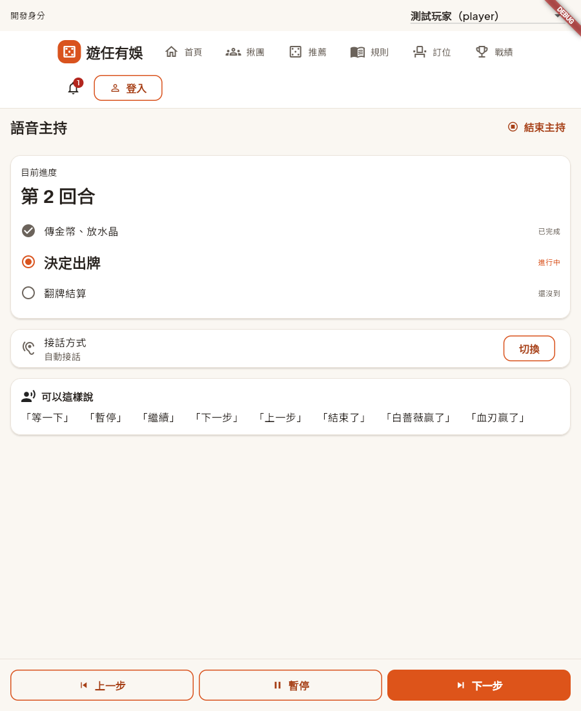
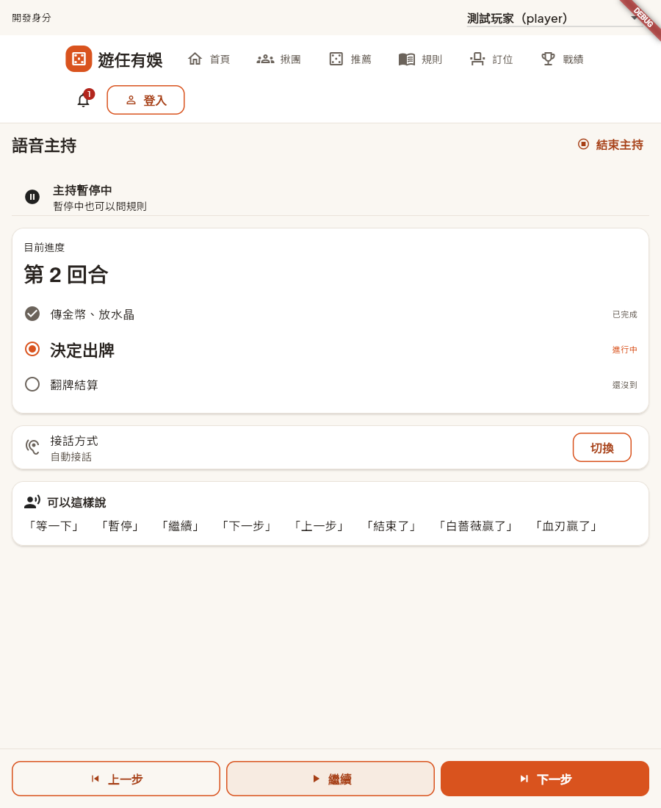
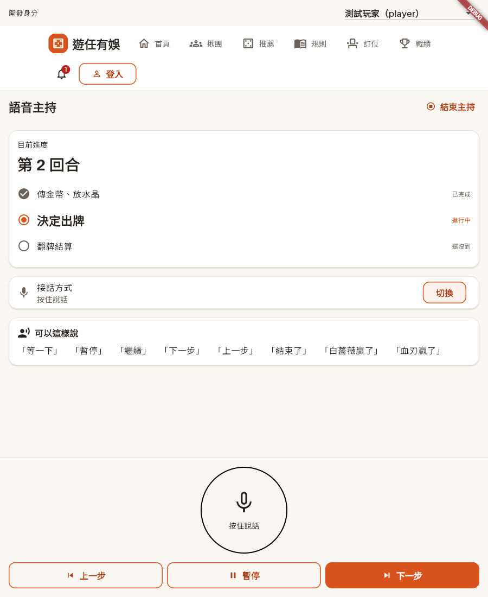
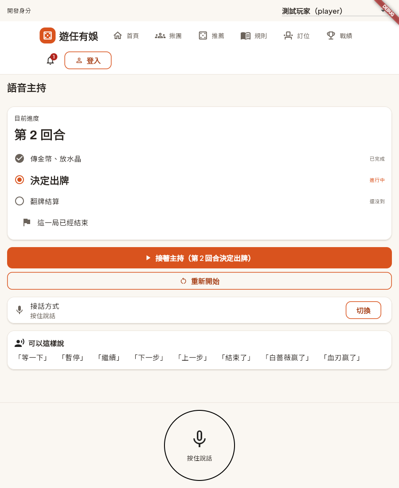
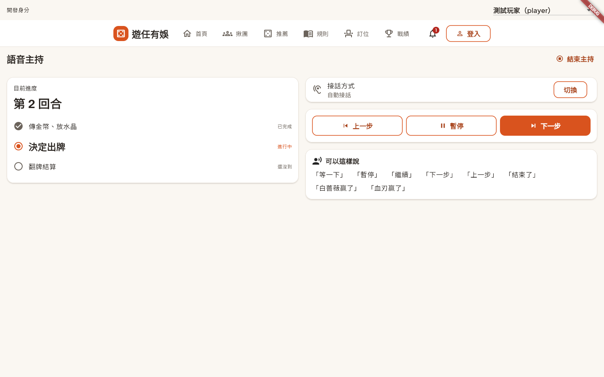
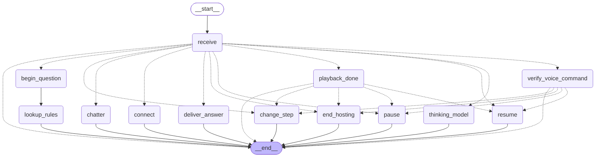

# 交接說明：host（AI 語音主持）

> 功能負責人填寫，交給永傑做正式頁面。格式依 AGENTS.md 5.4。

- 功能負責人：立倫
- 後端 domain：`host`（`backend/app/domains/host/`）
- 前端 `state/` 位置：`frontend/lib/domains/host/state/`（`host_controller.dart`、`host_labels.dart`）
- 參考畫面路由：`/proto/host`（啟動需帶 `--dart-define=SHOW_PROTOTYPES=true`）
- 範圍：只做《血與刃的白薔薇》一款，只支援中文。主持不存資料，後端重啟後進行中的主持會消失。
- 規格：[`.scratch/host/spec.md`](../../.scratch/host/spec.md) 第 14 節。設計稿（配色與排版只是提案，正式的樣子由你決定）：[v2](../../.scratch/host/prototypes/ui-mockups/v2/README.md)、[v1](../../.scratch/host/prototypes/ui-mockups/v1/README.md)。

## 1. 頁面清單

| 頁面 | 路由 | 用途 |
|---|---|---|
| 語音主持 | `/proto/host`（正式路由由你決定） | 一個頁面的兩種樣子：開主持前（選人數、接話方式、聲線）、主持中（進度、按鍵、語音指令的提示） |

還沒決定、交給你的：從 App 哪裡進來、手機要不要底部導覽列、平板版面。頁面名稱先用「語音主持」。

## 2. 各頁面的按鈕與欄位

所有操作都呼叫 `hostControllerProvider` 的方法，畫面上的值都從 `HostState` 讀。主持中的按鍵不是一般請求，是經 WebSocket 送一則訊息。

### 開主持前

| 元件 | 類型 | 按下／輸入後做什麼 | `state/` 方法 | 後端 API |
|---|---|---|---|---|
| （進頁面時） | — | 看有沒有可以接著的主持 | `load()` | `GET /api/v1/hosting-sessions` |
| 人數（5 到 10，加減鍵） | 按鈕 | 改人數，超出範圍不動。值讀 `state.playerCount` | `setPlayerCount(n)` | — |
| 接話方式：自動接話（預設）、按住說話 | 二選一 | 附註「主持中也可以切換」。值讀 `state.turnTakingMode` | `setTurnTakingMode(mode)` | — |
| 聲線：男聲（預設）、女聲 | 二選一 | 附註「開始後這場主持不能換」。值讀 `state.voice` | `setVoice(voice)` | — |
| 「開始主持」 | 按鈕 | 依序：請求麥克風與出聲 → 開主持 → 連線 → 開始收音 → 要求螢幕常亮 | `start()` | `POST /api/v1/hosting-sessions`，再連 `WS /api/v1/hosting-sessions/{id}/stream?ticket=…` |
| 「接著主持（第 N 回合某階段）」 | 按鈕 | 只在 `state.canResume` 為真時出現（有保留的主持，已結束的也算）。文字讀 `state.resumeLabel` | `resume()` | `POST /api/v1/hosting-sessions/{id}/connections`，再連 WebSocket |
| 「重新開始」 | 按鈕 | 只在 `state.canRestart` 為真時出現。舊的那場會被清掉 | `restart()` | 同「開始主持」 |

### 主持中

`state.isLive` 為真而且 `state.live` 有值時顯示。

| 元件 | 類型 | 按下／輸入後做什麼 | `state/` 方法 | 後端 API |
|---|---|---|---|---|
| 目前進度 | 顯示 | 回合內（`live.turnNumber` 有值）：第幾回合，加三個階段各是已完成、進行中、還沒到。開場到夜晚：節點名稱，用 `hostProgressLabel(...)`。階段名稱在 `hostPhaseNames` | — | 後端送的 `state` 訊息 |
| 主持人的狀態「正在查規則」 | 顯示 | `state.lookingUp` 為真時顯示 | — | `state` 訊息的 `looking_up` |
| 接話方式的標籤 | 顯示 | 讀 `state.turnTakingMode` | — | — |
| 「切換」 | 按鈕 | 關掉連線 → 帶另一種接話方式拿通行碼 → 重連。同一場主持接著走 | `switchTurnTakingMode()` | `POST …/{id}/connections`（帶 `turn_taking_mode`），再連 WebSocket |
| 「上一步」 | 按鈕 | 退到上一個節點 | `previous()` | WebSocket `command`：`previous` |
| 「暫停／繼續」 | 按鈕 | 文字用 `pauseButtonLabel(state)`，暫停中變成「繼續」 | `togglePause()` | WebSocket `command`：`pause` 或 `resume` |
| 「下一步」 | 按鈕 | 進下一個節點 | `next()` | WebSocket `command`：`next` |
| 「結束主持」 | 按鈕 | 不再確認（30 分鐘內可以接著主持） | `end()` | WebSocket `command`：`end` |
| 「可以這樣說」 | 文字 | 八句語音指令的提示，不能點：等一下、暫停、繼續、下一步、上一步、結束了、白薔薇贏了、血刃贏了 | — | — |
| 「按住說話」大按鈕 | 按住 | 只在 `state.showTalkButton` 為真時出現。按下去主持人立刻停；放開後主持人才回答。`state.talkHeld` 是按著的時候 | `talkDown()`、`talkUp()` | WebSocket `talk`：`down`、`up` |
| 已結束（`state.ended`） | 顯示 | 同時出現「接著主持」與「重新開始」。三顆流程鍵與「結束主持」只在 `state.showFlowControls` 為真時顯示，已結束後收起來（按了也不會動）；按住說話鍵還在，結束後照常可以問規則 | 同上 | 同上 |

不顯示的東西（已決定）：主持人與玩家的逐字稿、查到的規則內容、夜晚倒數的數字。

## 3. 狀態顯示

`state.notices` 是現在要顯示的提醒（可能同時好幾個）。字句是草稿，放在參考畫面的 `hostNoticeText`；標「已定」的不要改意思。

| 狀態（`HostNotice`） | 要顯示什麼 |
|---|---|
| 載入中／連線中（`connecting`） | 載入圖示 |
| 沒有資料（沒有保留的主持） | 只有「開始主持」，不顯示「接著主持」「重新開始」 |
| 主持暫停中（`paused`） | 「主持暫停中」，附「暫停中也可以問規則」（已定） |
| 頁面被切走後回來（`tapToResume`） | 「點一下繼續」（已定）。點了呼叫 `tapToResume()` |
| 螢幕常亮被拒（`wakeLockDenied`） | 一行「請關掉自動鎖定」，不擋主持（已定） |
| 重新連線中（`reconnecting`） | 「重新連線中」 |
| 聲音待啟用（`audioLocked`） | 「點一下開啟聲音」。點了呼叫 `unlockAudio()` |
| 錯誤：麥克風被拒絕（`micDenied`） | 「需要麥克風才能主持，請到瀏覽器設定允許」 |
| 錯誤：人數不對（`invalidPlayerCount`，後端 422） | 「人數要在 5 到 10 人」 |
| 錯誤：`HOST_REALTIME_UNAVAILABLE`（`unavailable`） | 「主持人暫時連不上，請稍後再試」，附「接著主持」 |
| 錯誤：`HOST_SESSION_TAKEN_OVER`（`takenOver`） | 「已在別的裝置接著主持」（已定） |
| 沒有權限（403，`forbidden`） | 「這場主持不是你開的」 |

`HOST_SESSION_NOT_FOUND`（主持已被清掉）沒有提醒：畫面回到開主持前，不再顯示「接著主持」。

## 4. 參考畫面截圖

2026-11-22 用筆電的瀏覽器接真的後端與真的語音模型截的。上方的「開發身分」與導覽列是 App 的外框，不是這一頁的內容。參考畫面只用 Flutter 預設元件，顏色與字型是 App 預設主題，正式的樣子由永傑決定；可以參考的是分區與按鍵擺放：

- 主持中，按鍵擺在提醒與進度改變時都不會被推動的位置，避免玩家連按時按空。手機與平板（寬度未滿 1024）的三顆流程鍵固定在畫面底部，按住說話鍵在流程鍵上面；筆電（1024 以上）分左右兩欄，左欄提醒、進度、正在查規則，右欄接話方式、流程鍵、可以這樣說。
- 「結束主持」放在標題列右邊，離流程鍵最遠，按「下一步」時不會誤按。
- 提醒分三種：要玩家點一下的是大按鈕（點一下繼續、點一下開啟聲音）；擋住主持的是橫幅（主持暫停中與各種錯誤）；只是告知的是一行（請關掉自動鎖定、重新連線中）。

以下 1 到 7 是 900 寬（單欄），8 是 1440 寬（兩欄）。

| 1 開主持前 | 2 有保留的主持 |
|---|---|
|  |  |

| 3 主持中：開場到夜晚 | 4 主持中：回合內 |
|---|---|
|  |  |

| 5 主持暫停中 | 6 按住說話 | 7 已結束 |
|---|---|---|
|  |  |  |

| 8 筆電：主持中（兩欄） |
|---|
|  |

## 5. 給永傑的備註

- `state/` 不夠用時，回報功能負責人修改，不要在頁面直接呼叫 API。
- 正式頁面完成後，刪除對應的參考畫面路由。
- 這一頁會用到麥克風、喇叭、螢幕常亮、頁面看不看得見，都包在 `frontend/lib/core/platform/` 的四個介面後面（`audio_capture`、`audio_playback`、`screen_wake_lock`、`page_visibility`），由控制器呼叫，頁面不用碰。
- 手機要 HTTPS 才能用麥克風；瀏覽器要玩家先點一下才能出聲，所以「開始主持」「接著主持」一定要是玩家自己按的按鈕。
- 離開頁面時控制器會自己停止收音、關掉連線；那場主持保留 30 分鐘，可以接著主持。
- 頁面被切走或鎖屏時，控制器會停止收音並通知後端暫停；回來後要玩家點一下才繼續。
- 主持中螢幕保持常亮。設計稿用深色底就是為了這個。

## 6. 流程圖

後端每收到一件事（按鍵、玩家的一句話、裝置回報播完、查規則的請求），就照下面這張圖跑一次。圖畫的是「後端怎麼處理一件事」，不是遊戲的階段；走到第幾回合、哪個階段記在整局記憶裡。圖裡只有 `thinking_model`（思考模型）會叫 LLM，其他節點都是照規則跑的程式。

由 LangGraph 輸出（`HostGraph().mermaid()`，2026-11-22），程式在 `backend/app/domains/host/graph.py`。

| 節點 | 做什麼 |
|---|---|
| `receive` | 入口，看這件事是哪一種 |
| `connect` | 裝置連上：還沒開場就交開場台詞；重新連線只說「回到第幾回合的哪個階段」 |
| `verify_voice_command` | 核對玩家的一句話是不是語音指令（整句就是指令才算） |
| `playback_done` | 裝置回報一段話播完；開場與夜晚兩步播完會自動進下一步 |
| `change_step` | 下一步、上一步，並交出新節點要說的內容 |
| `pause`、`resume` | 主持暫停、繼續 |
| `end_hosting` | 結束，交結束台詞 |
| `chatter` | 閒聊：主持人被切斷就自動重講，最多 2 次 |
| `begin_question`、`lookup_rules` | 玩家問規則：查規則書的原文片段 |
| `thinking_model` | 難題交給思考模型 |
| `deliver_answer` | 把思考模型的答案（或來不及時改交片段）交給主持人 |

