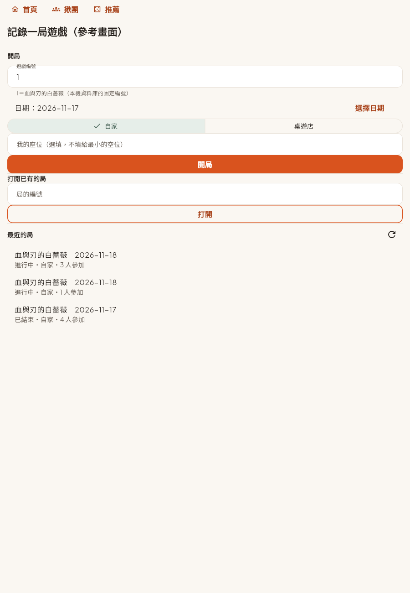

# 交接說明：matches（記錄一局遊戲）

> 功能負責人填寫，交給永傑做正式頁面。格式依 AGENTS.md 5.4。

- 功能負責人：新善（`matches` 主責，見 AGENTS.md 第 3 節）
- 後端 domain：`matches`（規格：`openspec/changes/add-matches-record/`）
- 前端 `state/` 位置：`frontend/lib/domains/matches/state/`
- 參考畫面路由：`/proto/matches`、`/proto/matches/:id`（啟動需帶 `--dart-define=SHOW_PROTOTYPES=true`）

這一版只做《血與刃的白薔薇》：回合內容、陣營都是白薔薇的格式（`state/white_rose.dart`、`TurnFormState`）。成就、天梯、其他遊戲的回合格式還沒做。

重要的行為（正式頁面請照做）：

- **沒有即時推送。** 一個人記錄，其他人按「重新整理」（`reload()`）看最新內容。
- **同一回合／同一結果已有紀錄時**，後端先回 409。`state/` 會進入「待確認覆蓋」狀態（`overwrite` 不為 null），畫面顯示 `overwritePromptText`＝「已經有人記錄了，要更新嗎？」與確認、取消兩個按鈕；確認後 `state/` 自動帶 `overwrite=true` 重送同一份內容。
- 「N 人參加、M 人有帳號、K 人已確認」與「有效紀錄」直接用 `MatchDetailState.participantSummary`、`validityLabel`，不要自己算。
- 按鈕要不要顯示，用 `state.actionsFor(userId)` 決定（`userId` 來自 `matchUserIdProvider`），頁面不要自己判斷。
- 日期是沒有時區的日曆日期（`yyyy-MM-dd`），不用換算時區。
- 畫面文字用「回合」（術語表 10.2）。

## 1. 頁面清單

| 頁面 | 參考畫面 | 用途 |
|---|---|---|
| 開局／找局 | `prototypes/matches/matches_proto_page.dart`（路由 `/proto/matches`） | 開局（選遊戲、日期、店家或自家、自己的座位）、用局的編號打開、最近的局清單 |
| 一局 | `prototypes/matches/match_detail_proto_page.dart`（路由 `/proto/matches/:id`，開局成功或從清單點進去） | 局的資料與統計、參加者（加入／新增沒帳號的人／移除）、回合紀錄與表單、結果表單、確認 |

正式頁面的路由由永傑決定。開局成功後 `matchFormProvider` 的 `created` 不為 null，畫面據此跳到這一局。

## 2. 各頁面的按鈕與欄位

### 頁面：開局／找局

`state/`：`matchFormProvider`（`MatchFormNotifier`）、`matchShopsProvider`、`matchListProvider(groupId)`（參數 null＝不篩選）

| 元件 | 類型 | 按下／輸入後做什麼 | `state/` 方法 | 後端 API |
|---|---|---|---|---|
| 遊戲編號 | 輸入欄位 | 選遊戲（目前沒有遊戲清單 API，先輸入編號，1＝血與刃的白薔薇，見備註） | `setGameId(int?)` | — |
| 日期 | 日期選擇 | 預設今天 | `setPlayedOn(DateTime)` | — |
| 自家／桌遊店 | 切換 | 選地點類型；切到自家會清掉已選的店家 | `setLocationType('home'｜'shop')` | — |
| 店家 | 下拉選單（選桌遊店時才出現） | 選店家 | `setShopId(String)`；選項 `matchShopsProvider` | `GET /api/v1/shops`（booking 的 API） |
| 我的座位 | 輸入欄位（選填） | 開局者自己的座位，不填給最小的空位 | `setSeatNumber(int?)` | — |
| 開局 | 按鈕 | 驗證後送出；成功後 `created` 不為 null；送出中停用 | `submit()` | `POST /api/v1/matches` |
| 局的編號＋打開 | 輸入欄位＋按鈕 | 打開已有的局（例如朋友傳來的編號） | — | — |
| 最近的局 | 清單＋重新整理按鈕 | 每筆顯示遊戲、日期、狀態、地點、人數；點進去打開那一局 | `matchListProvider`（重新整理用 `ref.invalidate`） | `GET /api/v1/matches` |

#### 從揪團的「填入戰績」進來（`/matches?group_id=<揪團 id>`）

揪團頁的「填入戰績」只帶 `group_id`。戰績頁在 `initState` 後呼叫 `MatchFormNotifier.loadGroup(groupId)`，其餘由 `state/` 處理：

| 元件 | 類型 | 行為 | `state/` | 後端 API |
|---|---|---|---|---|
| 揪團名稱 | 卡片（上方） | 顯示這個揪團的名稱；讀取中顯示進度條 | `MatchFormState.group`、`groupLoading` | `GET /api/v1/groups/{id}` |
| 讀取揪團失敗 | 錯誤＋「重試」 | 不帶 `group_id`，下方表單照常可用；重試再讀一次 | `MatchFormState.groupError`、`loadGroup(id)` | 同上 |
| 開一局 | 表單 | 地點自動改成桌遊店並選好揪團的店家；日期用揪團開始日（台灣時間）；揪團**剛好只選一款遊戲**時遊戲自動選好，0 款或 2 款以上自己選 | `loadGroup(id)` | — |
| 開局 | 按鈕 | 帶 `group_id`。後端自動把該揪團的**正式成員**（不含候補）加為參加者：開局者用自己選的座位，其他人依加入揪團的順序給最小的空位 | `submit()` | `POST /api/v1/matches` |
| 最近的局 | 清單 | 只列這個揪團的局；點進行中的局可繼續記錄 | `matchListProvider(groupId)` | `GET /api/v1/matches?group_id=` |

- 只有該揪團的開團主、正式成員或 admin 可以帶 `group_id` 開局，其他人回 403（`PERMISSION_DENIED`）；候補也是 403。
- 之後要減人用「移除參加者」。

### 頁面：一局

`state/`：`matchDetailProvider(matchId)`（`MatchDetailNotifier`）、`turnFormProvider(matchId)`、`resultFormProvider(matchId)`（都是 autoDispose，頁面開著時才保留）

| 元件 | 類型 | 按下／輸入後做什麼 | `state/` 方法 | 後端 API |
|---|---|---|---|---|
| 重新整理 | 按鈕 | 重新查詢這一局（刷新期間保留舊內容，`refreshing` 為 true） | `reload()` | `GET /api/v1/matches/{id}` |
| 局的資料 | 文字 | 遊戲、日期、狀態、地點、開局者、結果 | `MatchDetailState.match` | 同上 |
| 人數與有效 | 文字 | 「N 人參加、M 人有帳號、K 人已確認」與「有效紀錄／尚未成為有效紀錄」 | `participantSummary`、`validityLabel` | 同上 |
| 參加者清單 | 清單 | 座位、名字、有沒有帳號、陣營、獲勝與否、確認狀態；自己標示「（我）」 | `match.participants` | 同上 |
| 移除／退出 | 清單項目的按鈕（進行中且我是參加者才顯示） | **先跳確認對話框**；移除自己就是退出；座位已出現在回合時失敗（見第 3 節） | `remove(participantId)`；顯示條件 `canManageParticipants(userId)` | `DELETE /api/v1/matches/{id}/participants/{pid}` |
| 加入這一局＋座位 | 按鈕＋輸入欄位（不在這局且進行中） | 自己加入，座位選填 | `joinSelf({seatNumber})` | `POST /api/v1/matches/{id}/participants`，body 為 `{}` 或 `{"seat_number": n}` |
| 新增沒有帳號的人 | 名字＋座位輸入＋按鈕（在這局且進行中） | 名字不能空白；成功後清空欄位 | `addNamed(name, {seatNumber})` | `POST /api/v1/matches/{id}/participants`，body 帶 `display_name` |
| 確認這局的紀錄 | 按鈕（已結束、我是參加者、還沒確認） | 確認自己的紀錄 | `confirmMine()` | `PATCH /api/v1/matches/{id}/participants/{pid}`，`{"is_confirmed": true}` |
| 回合清單 | 清單 | 第幾回合、首家（有金幣）座位（沒填就不顯示）、出牌座位、雙刃／暗刃／巨刃／信者數量、有沒有白薔薇、有沒有司教 | `match.turns` | 同上 |
| 第幾回合 | 輸入欄位 | 預設從 1 開始，記完自動加 1 | `setTurnNumber(int)` | — |
| 首家（有金幣，選填） | 下拉選單 | 預設不選（選項「不指定」）；沒選時送出 `seat_number = null` | `setFirstSeat(int?)` | — |
| 出牌的座位 | 可點選的標籤（每個座位一個） | 點選／取消；這回合什麼都沒發生（數量都是 0、白薔薇與司教都沒開）時可以都不選，送出空陣列；有記錄到牌卻沒選時顯示欄位錯誤 `playedSeatsRequiredText`（「這回合有記錄到牌，請選出牌的座位」） | `togglePlayedSeat(seat)` | — |
| 雙刃、暗刃、巨刃、信者 | 加減按鈕與數字 | 不小於 0 | `setCount(TurnCounter, value)` | — |
| 有白薔薇 | 開關 | 一局只有一朵：別的回合已經記過時，開關關著就不能按，下方顯示「第 N 回合已記錄」（`recordedTurnOf(OnceCard.whiteRose, turns, editingTurn:)`、`onceCardReason`）；同一回合覆蓋時不受限 | `setHasWhiteRose(bool)` | 後端重複時回 409 `MATCH_WHITE_ROSE_ALREADY_RECORDED` |
| 司教 | 開關 | 一局只有一位司教，只記這回合有沒有出現；不能按的規則同白薔薇（`OnceCard.cardinal`） | `setHasCardinal(bool)` | 後端重複時回 409 `MATCH_CARDINAL_ALREADY_RECORDED` |
| 記錄這個回合 | 按鈕 | 驗證（回合編號從 1 開始；有記錄到牌就要選出牌座位；白薔薇、司教一局一次；首家選填）後送出；成功後清空表單並前進到下一回合 | `submit()` | `POST /api/v1/matches/{id}/turns` |
| 覆蓋提示＋更新／取消 | 提示區塊與兩個按鈕（`turnFormState.overwrite` 不為 null 時顯示） | 「更新」帶 `overwrite=true` 重送；「取消」只清除提示 | `confirmOverwrite()`／`cancelOverwrite()` | `POST /api/v1/matches/{id}/turns?overwrite=true` |
| 獲勝陣營 | 下拉選單 | 薔薇陣營／血刃陣營 | `setWinningFaction(code)`；選項 `whiteRoseFactions` | — |
| 每個座位的陣營 | 下拉選單（每個座位一個） | 每個座位都要選 | `setFaction(seat, code)` | — |
| 記錄結果 | 按鈕 | 驗證後送出；記錄結果的人自動確認 | `resultFormProvider.submit()` | `PUT /api/v1/matches/{id}/result` |
| 覆蓋提示＋更新／取消 | 同上（`resultFormState.overwrite`） | 更新會清除其他人的確認 | `confirmOverwrite()`／`cancelOverwrite()` | `PUT /api/v1/matches/{id}/result?overwrite=true` |
| 成功／錯誤提示 | 文字 | 各 state 的 `message`、`error` | — | — |

## 3. 狀態顯示

| 狀態 | 要顯示什麼 |
|---|---|
| 載入中 | 「載入中…」與轉圈（`match.isLoading`）；操作進行中（`busy`）停用按鈕並顯示進度條 |
| 沒有資料 | 最近的局為空：「還沒有任何一局，先開一局吧」；沒有回合紀錄：「還沒有回合紀錄（回合紀錄是選填的，只記結果也可以）」；沒有店家：「目前沒有可選的店家」 |
| 載入失敗 | 顯示後端的 `message` 與 `code`，附「重試」（`reload()`） |
| 操作失敗 | `error`（`ApiException`）：顯示 `message` 與 `code` |
| 已有紀錄（409 `MATCH_TURN_ALREADY_RECORDED`／`MATCH_RESULT_ALREADY_RECORDED`） | 不是錯誤：顯示「已經有人記錄了，要更新嗎？」與既有紀錄的簡述，兩個按鈕 |
| 座位被回合擋下（409 `MATCH_PARTICIPANT_HAS_TURNS`） | 顯示訊息與 `error.details['turn_numbers']`（相關回合）；要先覆蓋那些回合才能移除 |
| 沒有權限（403） | 顯示 `message`。只有這一局有帳號的參加者（或 admin）能新增沒帳號的人、移除、記回合、記結果；只有本人能確認。不是參加者的人只看得到資料與「加入」 |
| 局已結束再加入／移除（409 `MATCH_FINISHED`） | 顯示訊息；已結束的局不能再加入或移除參加者 |
| 還沒有結果就確認（409 `MATCH_RESULT_NOT_RECORDED`） | 顯示訊息（正常情況按鈕不會出現） |
| 遊戲沒設定結果類型（409 `MATCH_GAME_RESULT_TYPE_NOT_SET`） | 顯示訊息；回合仍可記錄 |
| 座位不存在／座位重複（422） | 顯示訊息；結果少座位時 `MATCH_RESULT_SEATS_INCOMPLETE` 的 `details.missing_seat_numbers` 列出缺的座位 |
| 欄位錯誤 | `MatchFormState.errors`、`TurnFormState.errors`、`ResultFormState.errors`（鍵是欄位名）顯示在對應欄位旁 |

## 4. 參考畫面截圖

用 `flutter build web --dart-define=SHOW_PROTOTYPES=true --dart-define=API_BASE_URL=http://localhost:8001` 建置，接本機後端，以 Chrome 開啟的畫面（資料是真的，不是假資料）。

| 畫面 | 截圖 |
|---|---|
| 開局／找局 |  |
| 一局（進行中：有參加者、一個回合、回合表單、結果表單） |  |
| 一局（已結束：結果與確認狀態） |  |

## 5. 給永傑的備註

- `state/` 不夠用時，回報功能負責人修改，不要在頁面直接呼叫 API。
- 正式頁面完成後，刪除對應的參考畫面路由（`app/router.dart` 的 `/proto/matches`、`/proto/matches/:id`）。
- 類別叫 `GameMatch`，因為 `Match` 是 Dart 內建的正規表示式類別。
- **選遊戲目前沒有 API。** 後端沒有 `GET /api/v1/games`，參考畫面只好輸入遊戲編號（本機資料庫的 1 號是血與刃的白薔薇，見 ADR 0003）。正式頁面要做遊戲選單的話，要先請立倫（`games` 擁有者）加遊戲清單 API。
- 店家清單借用 booking 的 `GET /api/v1/shops`（`matchShopsProvider`）。
- 目前使用者的 id 來自 `matchUserIdProvider`（取自開發用身分切換器）；`auth` 完成後只改這一處。
- 回合表單與陣營選項目前只有白薔薇（`TurnFormState` 的四種數量、`whiteRoseFactions`）。其他遊戲要用別的格式時，要新增各自的表單狀態。
- 切換開發身分後，一局的按鈕會跟著變（用 `actionsFor` 重新計算），不需要重新整理；但要看到別人剛做的操作還是要按重新整理。
- `matchDetailProvider`、`turnFormProvider`、`resultFormProvider` 是 autoDispose：畫面要一直 `watch` 它們，離開畫面時表單內容會被丟掉。
