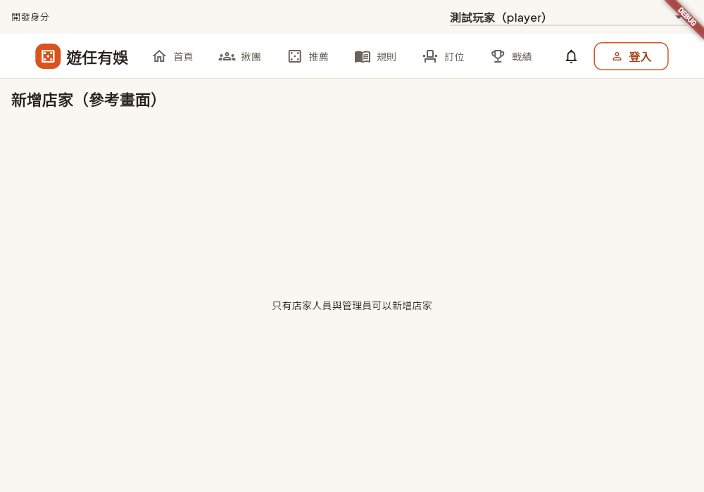
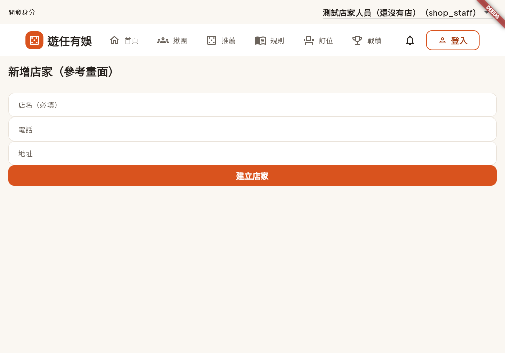
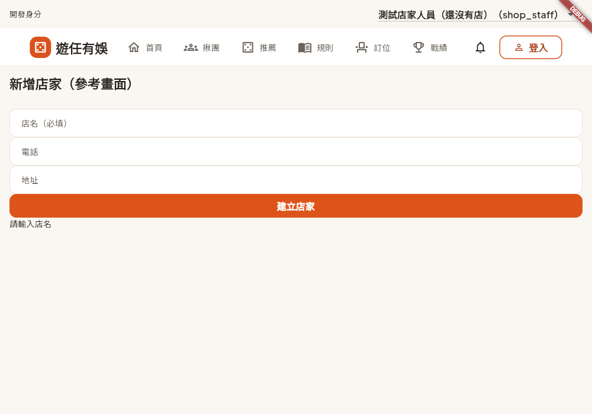
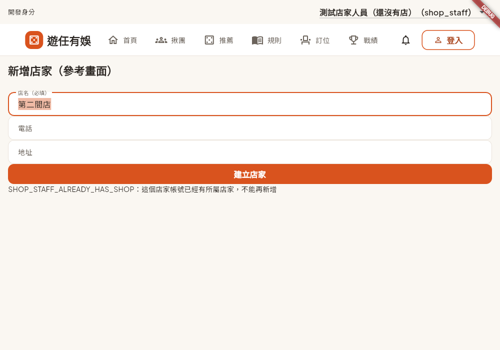
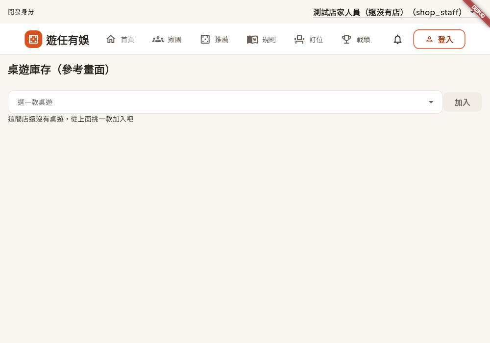
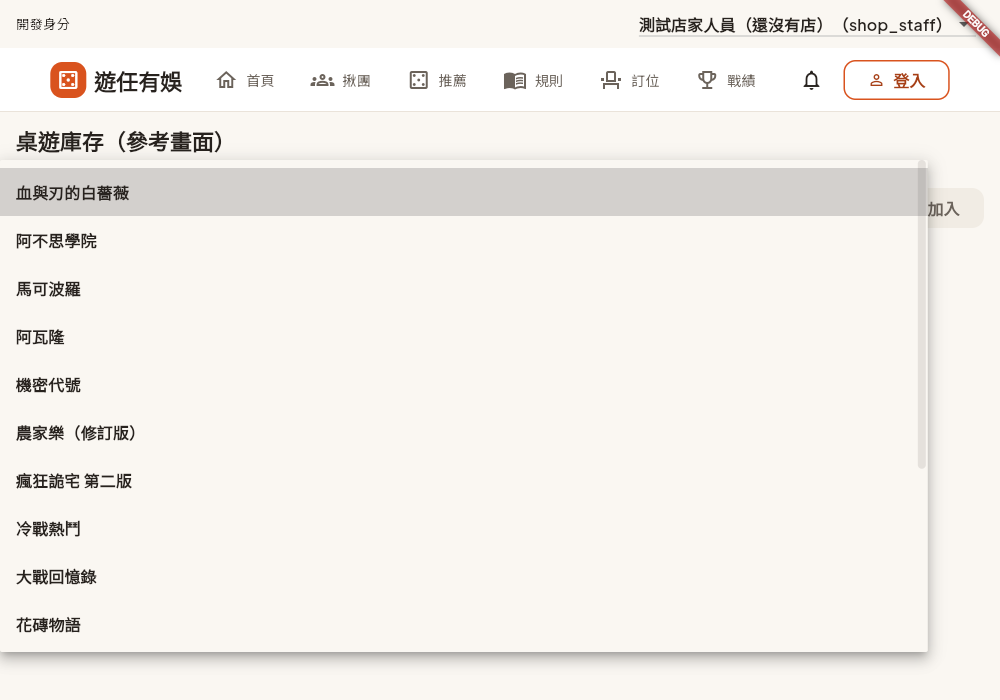
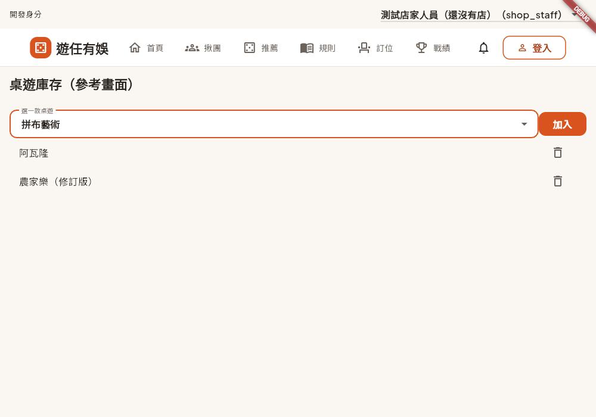
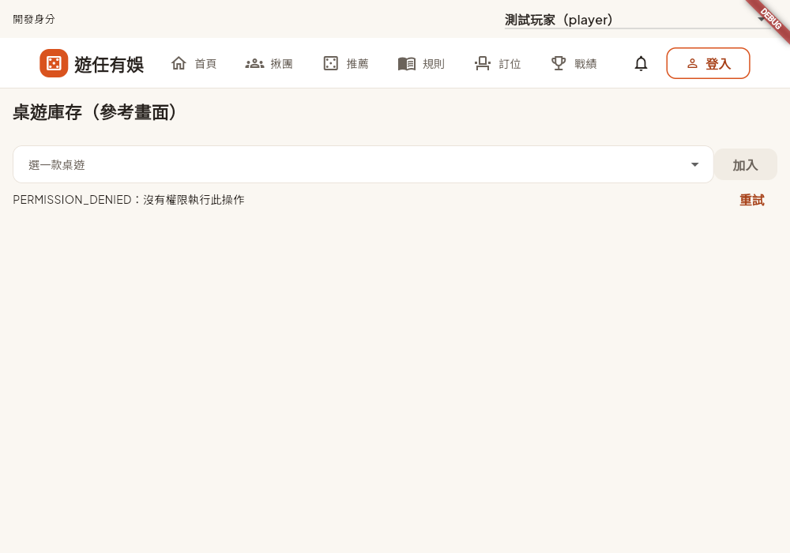
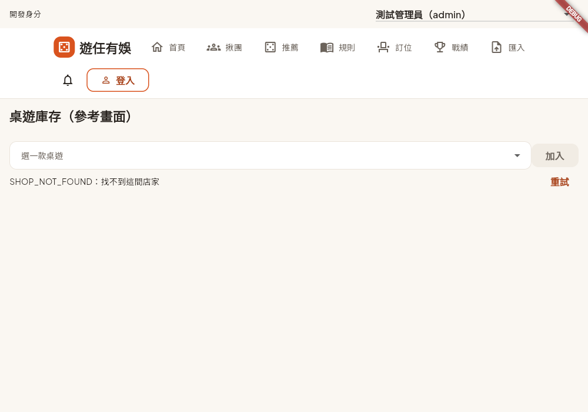

# 交接說明：shops

> 功能負責人填寫，交給永傑做正式頁面。格式依 AGENTS.md 5.4。

- 功能負責人：立倫（`shops` 主責，見 AGENTS.md 第 3 節）
- 後端 domain：`shops`
- 前端 `state/` 位置：`frontend/lib/domains/shops/state/`
- 參考畫面路由：`/proto/shops`、`/proto/shops/new`、`/proto/shops/:shopId/games`（啟動需帶 `--dart-define=SHOW_PROTOTYPES=true`）

功能範圍：店家人員新增自己的店家，並管理這間店有哪些桌遊（只記有沒有，不記數量）。管理員可以新增店家、管理任何一間店的庫存。玩家不能使用。

## 1. 頁面清單

| 頁面 | 路由 | 用途 |
|---|---|---|
| 店家入口 | `/proto/shops`（`prototypes/shops/shops_entry_proto_page.dart`） | 自己不顯示內容，依身分轉到下面兩頁之一 |
| 新增店家 | `/proto/shops/new`（`shop_create_proto_page.dart`） | 填店名、電話、地址，建立店家；成功後前往新店的庫存頁 |
| 桌遊庫存 | `/proto/shops/:shopId/games`（`shop_inventory_proto_page.dart`） | 列出這間店的桌遊、加入一款、移除一款 |

三個頁面共用同一個 `state/`：`shopsProvider`（`ShopsNotifier`，狀態是 `ShopsState`）。

## 2. 各頁面的按鈕與欄位

### 頁面：店家入口

| 元件 | 類型 | 按下／輸入後做什麼 | `state/` 方法 | 後端 API |
|---|---|---|---|---|
| 載入中圖示 | 圖示 | 進頁面後立刻轉頁，不需要操作 | `resolveShopsEntryPath(currentDevUser, shopsState.createdShop?.id)` 回傳要去的路徑 | — |

轉到哪一頁：

| 情況 | 去哪裡 |
|---|---|
| 這次開啟網頁後剛新增過店家 | 新店的庫存頁 |
| 店家人員、已經有店 | 自己店的庫存頁 |
| 店家人員、還沒有店 | 新增店家 |
| 管理員 | 新增店家 |

### 頁面：新增店家

| 元件 | 類型 | 按下／輸入後做什麼 | `state/` 方法 | 後端 API |
|---|---|---|---|---|
| 店名（必填） | 輸入欄位 | — | — | — |
| 電話 | 輸入欄位 | 選填 | — | — |
| 地址 | 輸入欄位 | 選填 | — | — |
| 建立店家 | 按鈕 | 送出三個欄位。店名去掉前後空白後是空的，就顯示「請輸入店名」，不呼叫後端。電話、地址留空就不送。進行中（`loading`）按鈕停用、文字變「建立中…」 | `createShop(name:, phone:, address:)` | `POST /api/v1/shops` |
| 成功後轉頁 | 自動 | 頁面監看 `ShopsState.createdShop`，有新的店就前往 `/shops/<新店 id>/games`（參考畫面是 `/proto/shops/...`） | `ShopsState.createdShop` | — |
| 錯誤訊息 | 文字 | `isError` 為 true 時顯示 `message` | `ShopsState.isError`、`ShopsState.message` | — |
| 沒有權限的提示 | 文字 | 目前身分不是 `shop_staff` 或 `admin` 時，整頁只顯示「只有店家人員與管理員可以新增店家」，不顯示表單 | `currentDevUserProvider` 的 `role` | — |

### 頁面：桌遊庫存

進頁面時先載入可以挑選的桌遊，再載入這間店的庫存（順序的原因見第 5 節）。

| 元件 | 類型 | 按下／輸入後做什麼 | `state/` 方法 | 後端 API |
|---|---|---|---|---|
| 選一款桌遊 | 下拉選單 | 列出還沒在庫存裡的桌遊（`choices` 扣掉 `inventory` 已有的，這一步在頁面做）。選取後才能按「加入」 | `loadChoices()`；清單在 `ShopsState.choices` | `GET /api/v1/games` |
| 加入 | 按鈕 | 把選取的桌遊加入庫存，成功後清單自動更新。沒有選取或進行中時停用 | `addGame(shopId, gameId)` | `POST /api/v1/shops/{shop_id}/games`，body `{"game_id": 1}` |
| 庫存清單 | 清單 | 每一列顯示桌遊名稱，依加入先後排 | `loadInventory(shopId)`；清單在 `ShopsState.inventory` | `GET /api/v1/shops/{shop_id}/games` |
| 移除（垃圾桶） | 每一列的按鈕 | 移除這一款，成功後清單自動更新。進行中時停用。參考畫面沒有確認對話框，要不要加由永傑決定 | `removeGame(shopId, gameId)` | `DELETE /api/v1/shops/{shop_id}/games/{game_id}` |
| 錯誤訊息 | 文字 | `isError` 為 true 時顯示 `message` | `ShopsState.isError`、`ShopsState.message` | — |
| 重試 | 按鈕（和錯誤訊息一起出現） | 重新載入桌遊清單與庫存 | `loadChoices()`、`loadInventory(shopId)` | 同上 |

操作成功時 `ShopsState.message` 也有文字（「已新增店家「店名」」「庫存共 N 款」「已加入庫存」「已移除」），這時 `isError` 是 false。參考畫面只顯示錯誤，成功訊息要不要顯示由永傑決定。

## 3. 狀態顯示

| 狀態 | 要顯示什麼 |
|---|---|
| 載入中 | 庫存頁：`loading` 為 true 而且 `inventoryLoaded` 為 false 時顯示載入中圖示。之後的加入、移除只把按鈕停用，清單照常顯示。新增店家：按鈕停用並顯示「建立中…」 |
| 沒有資料 | 庫存頁：`inventoryLoaded` 為 true 而且 `inventory` 是空的，顯示「這間店還沒有桌遊，從上面挑一款加入吧」 |
| 錯誤（依 `error.code` 區分） | `message` 的格式是「代碼：後端的訊息」，直接顯示即可。各代碼見下表 |
| 沒有權限（403） | 新增店家：玩家進來只看到提示文字，不會送出請求。庫存頁：玩家、還沒有店的店員、別間店的店員會收到 403，顯示「PERMISSION_DENIED：沒有權限執行此操作」與「重試」 |

| `error.code` | 狀態碼 | 什麼時候出現 | 顯示的訊息 |
|---|---|---|---|
| `SHOP_STAFF_ALREADY_HAS_SHOP` | 409 | 已經有店的店家人員再新增店家 | 這個店家帳號已經有所屬店家，不能再新增 |
| `VALIDATION_ERROR` | 422 | 店名缺少或只有空白。前端已經先擋下（顯示「請輸入店名」），正常操作不會收到 | 後端的訊息 |
| `SHOP_GAME_ALREADY_EXISTS` | 409 | 加入已經在庫存裡的桌遊。下拉選單已經排除，只有兩個人同時操作同一間店時才會遇到 | 這間店已經有這款桌遊 |
| `GAME_NOT_FOUND` | 404 | 加入的桌遊不存在（清單載入後被刪掉） | 找不到這款桌遊 |
| `SHOP_GAME_NOT_FOUND` | 404 | 移除的桌遊已經不在庫存（別人先移除了） | 這間店的庫存沒有這款桌遊 |
| `SHOP_NOT_FOUND` | 404 | 網址上的店家不存在 | 找不到這間店家 |
| `PERMISSION_DENIED` | 403 | 見上表「沒有權限」 | 沒有權限執行此操作 |
| `NETWORK_ERROR` | — | 連不到後端 | 無法連線到伺服器 |

## 4. 參考畫面截圖

新增店家：

| 狀態 | 截圖 |
|---|---|
| 玩家進來（沒有權限） |  |
| 表單（還沒有店的店家人員） |  |
| 店名空白 |  |
| 已經有店的店家人員再新增（409） |  |

桌遊庫存：

| 狀態 | 截圖 |
|---|---|
| 沒有資料（剛新增完店家） |  |
| 打開下拉選單 |  |
| 有兩款桌遊，已選好第三款 |  |
| 玩家進來（403） |  |
| 店家不存在（404） |  |

店家入口只有一個載入中圖示，馬上轉頁，沒有截圖。截圖上方的導覽列與「開發身分」切換器是開發版的畫面框架，不屬於參考畫面。

## 5. 給永傑的備註

- **導覽列要加「店家」。** 只有 `shop_staff` 與 `admin` 看得到，玩家與沒有身分的人看不到。寫法可以比照 `frontend/lib/app/navigation.dart` 的 `adminNavItems`。這一項原本做在這支 MR 裡，後來連同測試一起拿掉，留給正式頁面。
- **正式路由請沿用 `/shops`、`/shops/new`、`/shops/:shopId/games`。** 入口要去哪一頁用 `resolveShopsEntryPath`，它回傳的就是這三個正式路徑。參考畫面掛在 `/proto` 底下，所以在頁面裡自己加了 `/proto` 前綴；正式頁面不用加。
- **剛新增完店家時，身分裡的店家還是舊的。** 身分（`currentDevUserProvider`）只來自請求帶的資訊，新增店家後不會跟著更新，所以要以新店的 id（`ShopsState.createdShop.id`）為準。`resolveShopsEntryPath` 已經處理：有 `createdShopId` 就先用它。後端的權限以資料庫為準，所以店家人員新增完不用換身分，就能管理新店。
- **庫存頁請先呼叫 `loadChoices()`，再呼叫 `loadInventory()`。** `state/` 每次操作成功都會把錯誤清掉。先載入庫存的話，它的錯誤（403、404）會被後面成功的桌遊清單蓋掉，畫面上看不到。
- **`shopsProvider` 不會在離開頁面時清空。** 看過 A 店的庫存後再開 B 店，如果 B 店載入失敗，`inventory` 還是 A 店的資料。參考畫面沒有處理這個情況；正式頁面需要時請回報立倫修改 `state/`。
- **下拉選單目前最多 20 款桌遊。** `data/` 呼叫 `GET /api/v1/games` 沒有帶分頁參數，只拿到第一頁。目前的示範資料是 16 款，夠用；桌遊變多時請回報立倫修改。
- `state/` 不夠用時，回報功能負責人修改，不要在頁面直接呼叫 API。
- 正式頁面完成後，刪除對應的參考畫面路由。
