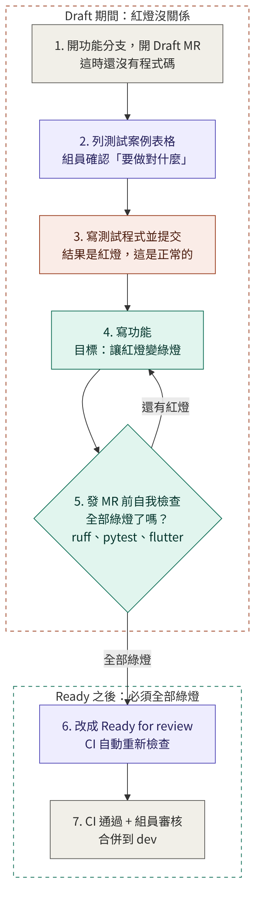
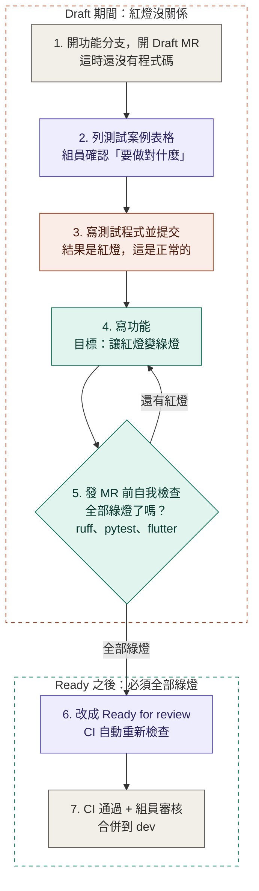

# 測試案例優先的開發流程

> 本文件是 `AGENTS.md` 第 7 節的圖解版，給組員閱讀。規則以 `AGENTS.md` 為準。

## 一句話說明

**測試案例是「事先約定要做對什麼」，發 MR 前的檢查是「確認現在的程式有沒有做到約定」。** 兩者是同一套測試，只是用在不同時間點。

## 流程圖（GitHub 上可直接顯示）

顏色：紫色是要由人確認的步驟，紅色是紅燈階段，綠色是讓紅燈變綠燈的階段。

## 每一步在做什麼（以訂位功能為例）

| 步驟 | 做什麼 | 訂位功能的例子 |
|---|---|---|
| 1. 開 Draft MR | 開好功能分支就在 GitHub 開 Draft Pull request，還不需要有程式碼 | 分支 `feature/booking-create`，開 Draft |
| 2. 列測試案例 | 在 MR 說明寫「情境／操作／預期結果」表格，@ 一位組員確認 | 空桌可以訂、重複訂要擋、人數超過要擋、沒登入要擋 |
| 3. 寫測試並提交 | 把表格寫成測試程式。功能還沒做，所以測試全部失敗 | 4 個測試，全部紅燈 |
| 4. 寫功能 | 一個一個把紅燈變綠燈 | 寫訂位 API |
| 5. 自我檢查 | 跑下方所有指令。還有紅燈就回到第 4 步 | 4 個測試全部綠燈，檢查也通過 |
| 6. Ready for review | 把 Draft 改成 Ready for review，GitHub 會在乾淨的環境自動重跑檢查 | CI 執行中 |
| 7. 合併 | CI 通過，加上一位組員審核通過，合併到 `dev` | 合併完成 |

## 發 MR 前自我檢查的指令

**後端**（在 `backend/` 資料夾執行）：

| 指令 | 檢查什麼 |
|---|---|
| `uv run ruff check .` | 程式碼有沒有常見錯誤、import 排序 |
| `uv run ruff format --check .` | 程式碼格式是否統一（要自動修正就拿掉 `--check`） |
| `uv run pytest` | 所有測試是否通過 |

**前端**（在 `frontend/` 資料夾執行）：

| 指令 | 檢查什麼 |
|---|---|
| `flutter analyze` | 程式碼有沒有錯誤或不建議的寫法 |
| `flutter test` | 所有測試是否通過 |

只改後端就只跑後端，只改前端就只跑前端；兩邊都改就全部跑。

## 常見問題

**Q：為什麼 Draft 期間可以紅燈？**
紅燈是這個流程的起點，代表「還沒做完」，不是「做錯了」。Draft 不會被合併，所以不會影響任何人。

**Q：為什麼不能先寫功能再補測試？**
先寫功能再補測試，AI 很容易照著已經寫好的程式去寫測試，結果測試只是在描述程式「現在的樣子」，而不是「應該做到的事」。先把約定寫下來給人確認，測試才真的抓得到錯誤。

**Q：測試好像寫錯了，可以改嗎？**
可以，但不能為了讓測試通過而偷改。在 MR 說明寫出為什麼測試是錯的，審核者同意後才能改。

**Q：可以用 `xfail` 或 `skip` 先讓紅燈消失嗎？**
不行。這等於把警報關掉，問題還在。
